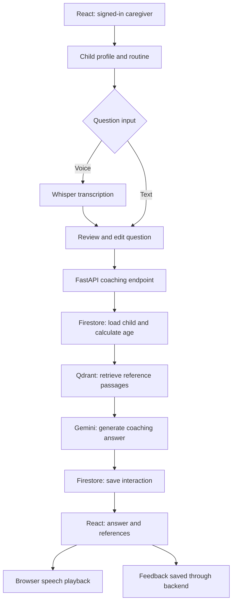

# Parenting Voice Assistant

A web application for caregivers of children from birth through 24 months.
Ask a question by voice or text, review developmental guidance with source
references, and listen to the answer.

[Release v0.1.0](https://github.com/Vinit-Rabadiya/parenting-voice-assistant/releases/tag/v0.1.0)
| [Release notes](RELEASE.md) | [Changelog](CHANGELOG.md)
| [Project issues](https://github.com/Vinit-Rabadiya/parenting-voice-assistant/issues)

## Features

- Email/password and Google sign-in, email verification, and TOTP authenticator access.
- Child profiles with create, edit, and switch controls, birth date, calculated age,
  baseline milestone display, and optional additional milestones.
- English voice recording up to 30 seconds, transcription after Stop, and editable text.
- Typed questions and optional routine context such as feeding, bathing, and play.
- Qdrant retrieval from 106 selected source-linked passages and Gemini-generated guidance.
- Reference titles, PDF page numbers, and source links displayed alongside answers.
- Browser speech playback with Listen/replay and Stop controls.
- Stored interactions and Helpful/Not helpful feedback with optional comments.
- Responsive interface with light and dark theme support.

The application supports developmental caregiver-child interaction. It is not
intended for medical diagnosis, treatment, or emergency assessment. Generated
answers can contain errors; references support review rather than guarantee every
claim. See [scope and availability](RELEASE.md#scope-and-availability).

## How it works

1. Sign in with a verified email and complete the authenticator challenge.
2. Add or select a child profile.
3. Type a question, or record speech and review the transcript.
4. Select an optional routine and click **Get guidance**.
5. The backend loads the child's stored birth date, calculates age, retrieves
   reference passages, and sends the question, age, routine, and passages to Gemini.
6. The answer and references appear on the page. Use **Listen** for spoken playback
   and submit feedback if desired.



Voice transcription runs locally through faster-whisper on CPU with INT8.
The default model is `tiny.en`; it is pretrained. Coaching uses retrieval-augmented generation. Speech output uses browser
`speechSynthesis`; audio is not synthesized by the backend.

## Technology stack

| Area | Implementation |
|---|---|
| Frontend | React 19, Vite 8, JavaScript, CSS |
| Backend | FastAPI, Uvicorn, Pydantic |
| Authentication | Firebase Web SDK and Admin SDK, verified email, TOTP |
| Storage | Cloud Firestore through backend Admin SDK |
| Speech recognition | faster-whisper and PyAV |
| Retrieval | Qdrant Cloud inference, all-MiniLM-L6-v2 embeddings |
| Coaching | google-genai SDK, configurable Gemini model |
| Speech playback | Browser Web Speech API |
| Checks | Pytest, Ruff, ESLint, Vitest, Node audio tests, GitHub Actions |

## Local setup

Commands below use Windows PowerShell from the repository root. For macOS/Linux,
use `venv/bin/python` in place of `.\venv\Scripts\python.exe` and `npm` in
place of `npm.cmd`.

### Prerequisites

- Python 3.12 or 3.13. Local verification used 3.13; backend CI uses 3.12.
- Node.js 22 and npm, matching frontend CI.
- A Firebase project configured for email/password, Google sign-in, and TOTP
  through Firebase Authentication with Identity Platform.
- A Firebase Admin service-account key and a default Firestore database.
- A Qdrant Cloud collection with cloud inference available.
- A Gemini API key and access to the configured model.
- Internet access for cloud services and the first Whisper model download.
- A browser supporting AudioWorklet and microphone access on localhost or HTTPS.

### 1. Install dependencies

```powershell
git clone https://github.com/Vinit-Rabadiya/parenting-voice-assistant.git
cd parenting-voice-assistant
python -m venv venv
.\venv\Scripts\python.exe -m pip install --upgrade pip
.\venv\Scripts\python.exe -m pip install -r requirements-dev.txt
npm.cmd ci --include=optional
npm.cmd --prefix frontend ci --include=optional
```

`requirements-dev.txt` includes the runtime and data-preparation requirements.
Root npm dependencies install the Husky development hooks.

### 2. Configure environment files

For a fresh checkout, copy the templates:

```powershell
Copy-Item .env.example .env
Copy-Item frontend/.env.example frontend/.env.local
```

If those files already exist, edit them rather than replacing your existing values.

Backend `.env`:

```dotenv
HOST=127.0.0.1
PORT=8000
FIREBASE_PROJECT_ID=your-firebase-project-id
FIREBASE_ADMIN_KEY_PATH=.secrets/firebase-admin.json
STT_MODEL=tiny.en
QDRANT_URL=https://your-cluster-url.qdrant.io
QDRANT_API_KEY=your-qdrant-api-key
QDRANT_COLLECTION=caregiver_guidance_minilm_v1
GEMINI_API_KEY=your-gemini-api-key
GEMINI_MODEL=gemini-3.8-flash
```

Place the Admin JSON key at the configured path. The service account must belong
to the configured Firebase project and have the required Firestore permissions.
The root `.env` and `.secrets/` directory are excluded from Git.

Frontend `frontend/.env.local`:

```dotenv
VITE_FIREBASE_API_KEY=your-firebase-web-api-key
VITE_FIREBASE_AUTH_DOMAIN=your-project-id.firebaseapp.com
VITE_FIREBASE_PROJECT_ID=your-project-id
VITE_FIREBASE_APP_ID=your-firebase-web-app-id
```

Use the Firebase Web App configuration, not the Admin private key. Restart the
backend after changing its environment settings and restart Vite after changing
frontend settings.

### 3. Configure Firebase and Firestore

In your Firebase project, enable Email/Password and Google authentication and add
`localhost` as an authorized domain. Enable Identity Platform support for TOTP.

Enable the Cloud Firestore API and create the default Firestore database in
production mode. Backend Admin SDK operations use service-account authorization;
the frontend does not write profiles or feedback directly.

Enable TOTP using the included administration script:

```powershell
node --env-file=.env scripts/enable-firebase-totp.mjs
```

To inspect TOTP configuration without changing it:

```powershell
node --env-file=.env scripts/check-firebase-auth.mjs
```

On first use, verify your email and enroll an authenticator in **My Account**.
After enrollment, sign out and sign in using the authenticator code.

### 4. Prepare the reference index

The source inventory is in `data/sources.json`. Obtain the matching PDFs and place
them in `data/raw/pdfs/` using the filenames in that inventory. Source documents,
generated passages, and local credentials are not included in the repository.

For a new index, run:

```powershell
.\venv\Scripts\python.exe -m scripts.prepare_rag_data
.\venv\Scripts\python.exe -m scripts.build_rag_passages
.\venv\Scripts\python.exe -m scripts.create_qdrant_collection
.\venv\Scripts\python.exe -m scripts.index_rag --upload
```

The final command writes to the configured Qdrant collection. An existing populated
index can be used without rebuilding it. See [data/README.md](data/README.md) for
source provenance and extraction details; current selections are maintained in
`data/passage-selections.json`.

### 5. Start the application

Backend terminal:

```powershell
.\venv\Scripts\python.exe -m uvicorn backend.main:app --reload --host 127.0.0.1 --port 8000
```

Wait for **Application startup complete**. The first Whisper load may download
model weights; later loads use the local cache. Use one worker for local use to
avoid loading duplicate speech models.

Frontend terminal:

```powershell
npm.cmd run dev:frontend
```

- Application: http://localhost:5173/
- API documentation: http://127.0.0.1:8000/docs
- Health endpoint: http://127.0.0.1:8000/health/live

Vite forwards `/api/*` to the backend and removes the `/api` prefix. Production
hosting requires an equivalent HTTPS API routing arrangement; Vite's development
proxy is not included in the static build.

## API overview

Protected endpoints require `Authorization: Bearer <Firebase ID token>`, verified
email, and a login completed with TOTP. Backend routes are also mounted under
`/api/v1`. See the generated API documentation for request/response schemas.

| Method | Route | Purpose |
|---|---|---|
| GET | `/health/live` | Public liveness check |
| GET | `/me` | Verify account access |
| GET | `/children` | List the authenticated user's profiles |
| POST | `/children` | Create a profile with name, date_of_birth, and optional milestones |
| PATCH | `/children/{child_id}` | Update an owned profile |
| POST | `/speech/transcribe` | Transcribe raw WAV audio |
| POST | `/coach` | Submit child_id, question, and optional routine |
| POST | `/coach/{interaction_id}/feedback` | Save helpful boolean and optional comment |

Speech requests accept mono PCM16 WAV at 16 kHz, up to 30 seconds, with a
964096-byte body limit. One transcription runs at a time per server process;
concurrent requests receive HTTP 429. The response includes `text`,
`audio_seconds`, and `processing_seconds`.

Coaching responses include `interaction_id`, `answer`, `citations`,
`child_age_months`, and `processing_seconds`. Playback is handled in the browser.

## Data handling

Firebase manages sign-in credentials. FastAPI verifies token validity and revocation,
email verification, and TOTP status before serving protected requests.

Profiles are stored under `users/{uid}/children/{id}`. Questions, answers, references,
timestamps, and feedback are stored under `users/{uid}/interactions/{id}`.
Recorded audio is processed for transcription and is not deliberately persisted by
the application. Edited text is submitted only when **Get guidance** is selected.

Qdrant Cloud inference processes question text for retrieval. Gemini receives the
question, calculated age, routine context, and retrieved reference passages.
Optional milestones are currently stored and displayed without affecting answer
generation. Consent, retention information, and account-data deletion controls
remain outstanding; use fictitious profiles for evaluation.

## Repository structure

```text
backend/
  api/dependencies.py       Shared service providers
  api/v1/endpoints/         Authentication, health, children, speech, coaching
  core/                     Configuration, Firebase initialization, token checks
  schemas/                  API request/response models
  services/                 Speech, retrieval, coaching, Firestore access
  main.py                   Application startup and route mounting
frontend/
  src/components/           Profiles, guidance workspace, recording, auth controls
  src/hooks/                Authentication, microphone, transcription lifecycle
  src/services/             Firebase and backend clients
  src/pages/                Landing, authentication, account screens
  public/audio/             AudioWorklet capture processor
data/
  sources.json              Source inventory and fingerprints
  passage-selections.json   Explicit passage selection rules
  evaluation/               Retrieval questions and recorded results
scripts/                    Data preparation, indexing, evaluation, checks
tests/                      Backend and frontend tests
.github/workflows/          CI configuration
CHANGELOG.md                Version history
RELEASE.md                  Release scope, requirements, and verification
```

## Verification

Run all configured checks:

```powershell
npm.cmd run check
```

This runs Ruff, Pytest, ESLint, Node audio-format tests, React tests, and the
production build. GitHub Actions runs backend checks and frontend lint/tests/build.

On 19 October 2026, 114 Python tests, 63 React tests, and 7 audio tests passed,
alongside both linters and the production build. Manual verification confirmed
answer generation and spoken playback. Audio-format tests do not measure speech
recognition accuracy or voice naturalness; full live-service and safety evaluation
are separate from the existing automated coverage.

## Troubleshooting

| Symptom | Check |
|---|---|
| Authentication temporarily unavailable | Backend internet access to Firebase; a healthy liveness endpoint does not verify cloud connectivity |
| Child profiles fail to load | Firestore API activation, default database creation, service-account permissions, and backend logs |
| Guidance generation fails | Qdrant/Gemini configuration, model access, quotas, and backend diagnostic messages |
| Frontend reports connection refused | Backend is ready on port 8000 and both development servers are running |
| Microphone is unavailable | Site permission, supported browser, and localhost or HTTPS |
| Port 8000 is occupied | Stop the earlier backend process before starting another instance |

## Development roadmap

Existing issues track retrieval quality and exact age handling, emergency triage
and response validation, privacy controls, conversation history, speech evaluation,
and production deployment. See [milestones](https://github.com/Vinit-Rabadiya/parenting-voice-assistant/milestones)
for planned work and [RELEASE.md](RELEASE.md) for the current release scope.
