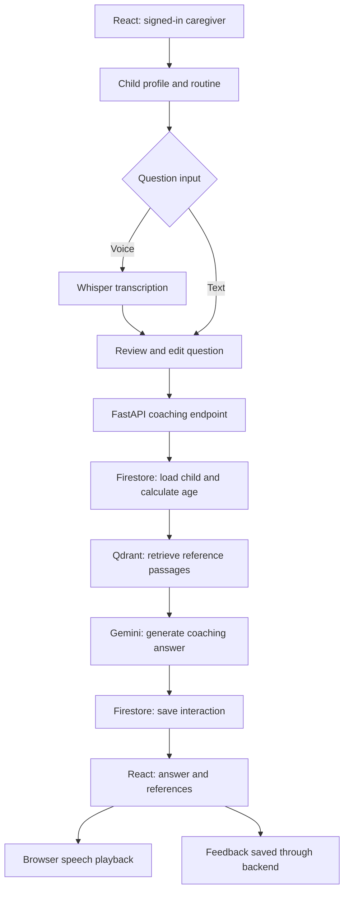

# Parenting Voice Assistant

A web application for caregivers of children from birth through 24 months.
Ask a question by voice or text, review developmental guidance with source
references, and listen to the answer.

[Release v0.1.0](https://github.com/Vinit-Rabadiya/parenting-voice-assistant/releases/tag/v0.1.0)
| [Release notes](RELEASE.md) | [Changelog](CHANGELOG.md)
| [Project issues](https://github.com/Vinit-Rabadiya/parenting-voice-assistant/issues)

## Features

- Email/password and Google sign-in, email verification, and TOTP authenticator access.
- Child profiles with create, edit, and switch controls, birth date, calculated age,
  baseline milestone display, and optional additional milestones.
- English voice recording up to 30 seconds, transcription after Stop, and editable text.
- Typed questions and optional routine context such as feeding, bathing, and play.
- Qdrant retrieval from 106 selected source-linked passages and Gemini-generated guidance.
- Reference titles, PDF page numbers, and source links displayed alongside answers.
- Browser speech playback with Listen/replay and Stop controls.
- Stored interactions and Helpful/Not helpful feedback with optional comments.
- Responsive interface with light and dark theme support.

The application supports developmental caregiver-child interaction. It is not
intended for medical diagnosis, treatment, or emergency assessment. Generated
answers can contain errors; references support review rather than guarantee every
claim. See [scope and availability](RELEASE.md#scope-and-availability).

## How it works

1. Sign in with a verified email and complete the authenticator challenge.
2. Add or select a child profile.
3. Type a question, or record speech and review the transcript.
4. Select an optional routine and click **Get guidance**.
5. The backend loads the child's stored birth date, calculates age, retrieves
   reference passages, and sends the question, age, routine, and passages to Gemini.
6. The answer and references appear on the page. Use **Listen** for spoken playback
   and submit feedback if desired.



Voice transcription runs locally through faster-whisper on CPU with INT8.
The default model is `tiny.en`; it is pretrained. Coaching uses retrieval-augmented generation. Speech output uses browser
`speechSynthesis`; audio is not synthesized by the backend.

## Technology stack

| Area | Implementation |
|---|---|
| Frontend | React 19, Vite 8, JavaScript, CSS |
| Backend | FastAPI, Uvicorn, Pydantic |
| Authentication | Firebase Web SDK and Admin SDK, verified email, TOTP |
| Storage | Cloud Firestore through backend Admin SDK |
| Speech recognition | faster-whisper and PyAV |
| Retrieval | Qdrant Cloud inference, all-MiniLM-L6-v2 embeddings |
| Coaching | google-genai SDK, configurable Gemini model |
| Speech playback | Browser Web Speech API |
| Checks | Pytest, Ruff, ESLint, Vitest, Node audio tests, GitHub Actions |

## Local setup

Commands below use Windows PowerShell from the repository root. For macOS/Linux,
use `venv/bin/python` in place of `.\venv\Scripts\python.exe` and `npm` in
place of `npm.cmd`.

### Prerequisites

- Python 3.12 or 3.13. Local verification used 3.13; backend CI uses 3.12.
- Node.js 22 and npm, matching frontend CI.
- A Firebase project configured for email/password, Google sign-in, and TOTP
  through Firebase Authentication with Identity Platform.
- A Firebase Admin service-account key and a default Firestore database.
- A Qdrant Cloud collection with cloud inference available.
- A Gemini API key and access to the configured model.
- Internet access for cloud services and the first Whisper model download.
- A browser supporting AudioWorklet and microphone access on localhost or HTTPS.

### 1. Install dependencies

```powershell
git clone https://github.com/Vinit-Rabadiya/parenting-voice-assistant.git
cd parenting-voice-assistant
python -m venv venv
.\venv\Scripts\python.exe -m pip install --upgrade pip
.\venv\Scripts\python.exe -m pip install -r requirements-dev.txt
npm.cmd ci --include=optional
npm.cmd --prefix frontend ci --include=optional
```

`requirements-dev.txt` includes the runtime and data-preparation requirements.
It also installs lint and test tooling; `requirements.txt` is the runtime install.
Root npm dependencies install the Husky development hooks.

### 2. Configure environment files

For a fresh checkout, copy the templates:

```powershell
Copy-Item .env.example .env
Copy-Item frontend/.env.example frontend/.env.local
```

If those files already exist, edit them rather than replacing your existing values.

Backend `.env`:

```dotenv
HOST=127.0.0.1
PORT=8000
FIREBASE_PROJECT_ID=your-firebase-project-id
FIREBASE_ADMIN_KEY_PATH=.secrets/firebase-admin.json
STT_MODEL=tiny.en
QDRANT_URL=https://your-cluster-url.qdrant.io
QDRANT_API_KEY=your-qdrant-api-key
QDRANT_COLLECTION=caregiver_guidance_minilm_v1
GEMINI_API_KEY=your-gemini-api-key
GEMINI_MODEL=gemini-3.5-flash-lite
GEMINI_FALLBACK_MODEL=gemini-3.8-flash
```

The documented Uvicorn command explicitly sets the bind address and port. The
`HOST` and `PORT` application settings do not override those command-line options.
If changing the backend port, also update the Vite development proxy target.

For verification, `npm.cmd run lint` runs only Python/frontend lint and
`npm.cmd test` runs only Python/frontend tests. `npm.cmd run check` retains the
full lint, test, and frontend-build sequence used by the pre-push hook.

Flash Lite is the primary coaching model. If it returns a quota error (429),
the backend tries the fallback once with identical context and references.
Leave `GEMINI_FALLBACK_MODEL` empty to disable fallback. Each model receives one
SDK attempt; other errors do not trigger fallback. Fallback availability depends
on its own quota and does not guarantee lower latency. Restart the backend after
changing these settings. The selected model is recorded in technical logs.

Place the Admin JSON key at the configured path. The service account must belong
to the configured Firebase project and have the required Firestore permissions.
The root `.env` and `.secrets/` directory are excluded from Git.

Frontend `frontend/.env.local`:

```dotenv
VITE_FIREBASE_API_KEY=your-firebase-web-api-key
VITE_FIREBASE_AUTH_DOMAIN=your-project-id.firebaseapp.com
VITE_FIREBASE_PROJECT_ID=your-project-id
VITE_FIREBASE_APP_ID=your-firebase-web-app-id
```

Use the Firebase Web App configuration, not the Admin private key. Restart the
backend after changing its environment settings and restart Vite after changing
frontend settings.

### 3. Configure Firebase and Firestore

In your Firebase project, enable Email/Password and Google authentication and add
`localhost` as an authorized domain. Enable Identity Platform support for TOTP.

Enable the Cloud Firestore API and create the default Firestore database in
production mode. Backend Admin SDK operations use service-account authorization;
the frontend does not write profiles or feedback directly.

Conversation listing requires the composite index recorded in
`firestore.indexes.json`: collection `conversations`, collection scope,
`child_id` ascending and `updated_at` descending. Create this index in the
Firestore console before using conversation history. The file records the index
definition; starting the backend does not create or deploy it.

Enable TOTP using the included administration script:

```powershell
node --env-file=.env scripts/enable-firebase-totp.mjs
```

To inspect TOTP configuration without changing it:

```powershell
node --env-file=.env scripts/check-firebase-auth.mjs
```

On first use, verify your email and enroll an authenticator in **My Account**.
After enrollment, sign out and sign in using the authenticator code.

### 4. Prepare the reference index

The source inventory is in `data/sources.json`. Obtain the matching PDFs and place
them in `data/raw/pdfs/` using the filenames in that inventory. Source documents,
generated passages, and local credentials are not included in the repository.

For a new index, run:

```powershell
.\venv\Scripts\python.exe -m scripts.prepare_rag_data
.\venv\Scripts\python.exe -m scripts.build_rag_passages
.\venv\Scripts\python.exe -m scripts.create_qdrant_collection
.\venv\Scripts\python.exe -m scripts.index_rag --upload
```

The final command writes to the configured Qdrant collection. An existing populated
index can be used without rebuilding it. See [data/README.md](data/README.md) for
source provenance and extraction details; current selections are maintained in
`data/passage-selections.json`.

### 5. Start the application

Backend terminal:

```powershell
.\venv\Scripts\python.exe -m uvicorn backend.main:app --reload --host 127.0.0.1 --port 8000
```

Wait for **Application startup complete**. The first Whisper load may download
model weights; later loads use the local cache. Use one worker for local use to
avoid loading duplicate speech models.

Frontend terminal:

```powershell
npm.cmd run dev:frontend
```

- Application: http://localhost:5173/
- API documentation: http://127.0.0.1:8000/docs
- Health endpoint: http://127.0.0.1:8000/health/live

Vite forwards `/api/*` to the backend and removes the `/api` prefix. Production
hosting requires an equivalent HTTPS API routing arrangement; Vite's development
proxy is not included in the static build.

## API overview

Protected endpoints require `Authorization: Bearer <Firebase ID token>`, verified
email, and a login completed with TOTP. Backend routes are also mounted under
`/api/v1`. See the generated API documentation for request/response schemas.

| Method | Route | Purpose |
|---|---|---|
| GET | `/health/live` | Public liveness check |
| GET | `/me` | Verify account access |
| GET | `/children` | List the authenticated user's profiles |
| POST | `/children` | Create a profile with name, date_of_birth, and optional milestones |
| PATCH | `/children/{child_id}` | Update an owned profile |
| POST | `/speech/transcribe` | Transcribe raw WAV audio |
| POST | `/conversations` | Create a conversation for an owned child profile |
| GET | `/conversations?child_id=...` | List a child's conversations, newest first |
| GET | `/conversations/{conversation_id}` | Read a page of conversation messages |
| DELETE | `/conversations/{conversation_id}` | Delete a conversation and its messages |
| POST | `/coach` | Submit child_id, question, optional routine and conversation_id |
| POST | `/coach/{interaction_id}/feedback` | Rate an interaction or a conversation answer |

Speech requests accept mono PCM16 WAV at 16 kHz, up to 30 seconds, with a
964096-byte body limit. One transcription runs at a time per server process;
concurrent requests receive HTTP 429. The response includes `text`,
`audio_seconds`, and `processing_seconds`.

Coaching responses include `interaction_id`, `answer`, `citations`,
`child_age_months`, and `processing_seconds`. Playback is handled in the browser.

When `conversation_id` is supplied, `/coach` verifies that the conversation belongs
to the authenticated account and selected child. It saves the submitted message
and checked response together, then returns `conversation_id` and `message_id`;
`interaction_id` is null. Without a conversation ID, the existing interaction
storage and feedback contract remain available. New conversation messages are not
duplicated in the interactions collection.

For conversation feedback, put the assistant's `message_id` in the existing
feedback route and include `conversation_id` with `helpful` and optional `comment`
in the JSON body. Feedback is stored on that assistant message.

History reads accept a bounded `limit` and optional `before` document ID. For older
conversation pages, use the last returned conversation ID; for older message
pages, use the first returned message ID. Message pages are returned in reading
order. The interface can open saved conversations and display messages, sources,
audio controls, and feedback. Its composer uses one editable field for typed text
and speech transcription beneath the scrolling message thread. For conversation
requests, the backend loads at most six recent messages and selects up to three
complete answered exchanges within a 3,000-character budget. History helps
interpret follow-ups but is not reference evidence. Safety responses and
unsuccessful answers form a boundary: earlier turns are not carried past them.
Legacy interactions remain unchanged and are not yet included in the conversation
list.

Explicit short follow-ups such as "What else can I try?" include the recent
caregiver topic in reference search. A new standalone question keeps its own
search wording. No additional language-model rewrite call is used, and follow-ups
without a usable topic do not generate arbitrary guidance. Context is limited to
the selected conversation, not other chats or child profiles.
For requests for more ideas, the generation instructions distinguish new actions
from reworded or rearranged earlier advice. If the current references provide no
additional supported actions, the answer should acknowledge that instead of
filling another list. Requests for explanation may clarify a previous suggestion
without presenting it as new advice. These are prompt-level controls and require
live response evaluation; automated prompt tests do not establish semantic novelty.

## Data handling

Firebase manages sign-in credentials. FastAPI verifies token validity and revocation,
email verification, and TOTP status before serving protected requests.

Profiles are stored under `users/{uid}/children/{id}`. New conversation messages,
references, timestamps, and feedback are stored under
`users/{uid}/conversations/{id}/messages/{id}`. Earlier standalone interactions
remain under `users/{uid}/interactions/{id}`.
Recorded audio is processed for transcription and is not deliberately persisted by
the application. Edited text is submitted only when **Get guidance** is selected.

Qdrant Cloud inference processes question text for retrieval; explicit follow-ups
can also include a recent caregiver message from the selected conversation.
Gemini receives the question, current calculated age, routine, retrieved reference
passages, and bounded recent conversation context when available.
Optional milestones are currently stored and displayed without affecting answer
generation. The conversation privacy disclosure explains that application history
is retained until the conversation, child profile, or account is deleted.
This is not a claim about third-party
provider or backup retention. Account deletion is available in account settings.
Before new processing, the interface displays a versioned notice and requires
explicit acceptance and confirmation of caregiver authority. The backend records
`consent_version`, server-generated `consent_at`, and `caregiver_authority` on
`users/{uid}`. Existing accounts without a current record must also accept; no
consent is inferred from previously stored profiles.

Authenticated `GET /privacy/consent` returns the current notice and acceptance
status. `POST /privacy/consent` accepts only the current version with both explicit
confirmations. The backend checks consent before profile creation/updates, new
conversations, coaching, feedback, and transcription. A missing or outdated record
does not block existing-data reads, deletion, or account settings. The notice
offers a read-only history view without acceptance.

Child names and dates of birth are retained for profile identification and
age-aware guidance; profile photos are not collected. Consent withdrawal controls
and broader privacy requirements still need separate work;
this flow alone does not establish legal compliance. Use fictitious profiles for
evaluation. Change the notice version when its processing terms change so an old
acceptance cannot silently authorise new terms.

Account settings offer separate **Delete my data** and **Delete my account**
actions. Authenticated `DELETE /me/data` removes application data, including child
profiles, conversations, feedback, legacy interactions, and the consent record,
while retaining the login account. Consent must be accepted again before new
processing. `DELETE /me` also deletes the login account. Both actions require a
sign-in completed within the last five minutes and remain available without
consent. Deletion affects application storage, not third-party provider records
or backup copies.

Coaching requests have a 60-second browser wait limit and a **Stop waiting**
control in place of the Send arrow. Submitted messages appear immediately in the
thread and clear the input; failed or cancelled requests leave a local message
with an unconfirmed-answer status. Any new draft stays in the input. Cancellation
does not automatically retry.
It stops the browser waiting, not necessarily server processing: the answer may
still be saved. Reopen the conversation before deciding whether to send again.
Sources are collapsed by default and can be expanded for inspection.

## Repository structure

```text
backend/
  api/dependencies.py       Shared service providers
  api/v1/endpoints/         Authentication, health, children, speech, coaching
  core/                     Configuration, Firebase initialization, token checks
  schemas/                  API request/response models
  services/                 Speech, retrieval, coaching, Firestore access
  main.py                   Application startup and route mounting
frontend/
  src/components/           Profiles, guidance workspace, recording, auth controls
  src/hooks/                Authentication, microphone, transcription lifecycle
  src/services/             Firebase and backend clients
  src/pages/                Landing, authentication, account screens
  public/audio/             AudioWorklet capture processor
data/
  sources.json              Source inventory and fingerprints
  passage-selections.json   Explicit passage selection rules
  evaluation/               Retrieval questions and recorded results
scripts/                    Data preparation, indexing, evaluation, checks
tests/                      Backend and frontend tests
.github/workflows/          CI configuration
CHANGELOG.md                Version history
RELEASE.md                  Release scope, requirements, and verification
```

## Verification

Run all configured checks:

```powershell
npm.cmd run check
```

This runs Ruff, Pytest, ESLint, Node audio-format tests, React tests, and the
production build. GitHub Actions runs backend checks and frontend lint/tests/build.

On 19 October 2026, 114 Python tests, 63 React tests, and 7 audio tests passed,
alongside both linters and the production build. Manual verification confirmed
answer generation and spoken playback. Audio-format tests do not measure speech
recognition accuracy or voice naturalness; full live-service and safety evaluation
are separate from the existing automated coverage.

## Troubleshooting

| Symptom | Check |
|---|---|
| Authentication temporarily unavailable | Backend internet access to Firebase; a healthy liveness endpoint does not verify cloud connectivity |
| Child profiles fail to load | Firestore API activation, default database creation, service-account permissions, and backend logs |
| Guidance generation fails | Qdrant/Gemini configuration, model access, quotas, and backend diagnostic messages |
| Coaching service temporarily busy (503) | Gemini reported service unavailability. Retry later; the application does not add automatic retries. |
| Coaching service request limit reached (429) | Check the configured project's Gemini quota and usage. Wait for the limit to reset or review the account plan before retrying. |
| Guidance could not be provided (`safety_blocked`) | A generated answer matched an output guardrail. Only a replacement message is returned and stored; no source cards support the withheld answer. |
| Frontend reports connection refused | Backend is ready on port 8000 and both development servers are running |
| Microphone is unavailable | Site permission, supported browser, and localhost or HTTPS |
| Port 8000 is occupied | Stop the earlier backend process before starting another instance |

### Coaching output guardrails

After generation, `response_safety.py` checks common dose expressions, known
medication-instruction and diagnostic patterns, explicit conflicting age claims,
numeric citation bounds, model-generated links and source-record provenance.
Source cards must match the evidence records supplied to generation, including
their metadata. A blocked response is replaced before database storage and API
delivery. The frontend distinguishes `safety_blocked` from `no_evidence` and audio
playback reads only the returned replacement. Safety logs contain random request
identifiers, outcomes and reason codes, not conversation text.

These are limited deterministic guardrails, not comprehensive medical detection,
semantic grounding verification or expert clinical validation. The dose rule is
deliberately conservative and may block benign numerical references. Directly
negated medication instructions are exempted, but complex wording and unlisted
drugs or conditions can be missed. A passing check does not mean every claim is
supported by a source or that the answer is safe. Input danger-sign routing is
described separately below; broader scope classification remains outstanding. No additional model request
or change to the generation prompt is introduced.

The evaluation capture script applies the same checks. New records distinguish
`safety_blocked` outcomes and retain reason codes rather than the blocked generated
text. Earlier evaluation records remain unchanged; compare runs by code revision.

### Input danger-sign routing

`input_safety.py` checks English input after authenticated profile lookup and
before retrieval/generation. Recognized reports of breathing difficulty, inability
to feed, convulsions, unresponsiveness, dehydration, choking, injury and fever in
profiles under three completed calendar months return a fixed urgent-care referral.
The response uses `status: escalated` and `safety: escalate`; ordinary responses use
`safety: not_flagged`, which is not a medical safety clearance. Recognized reports
for aged-out managed profiles still receive the referral instead of only an age error.

Referral sources are predefined, not generated or retrieved by similarity. The
Kenya handbook's danger-sign passage supports its listed categories; WHO emergency
guidance and NHS accident guidance cover additional categories. Web references have
`pdf_page: null` rather than fabricated page numbers. Input safety logs contain reason
codes and random request identifiers, not symptom text. A failed interaction write
does not suppress the referral: `interaction_id` is then null and feedback is hidden.
Authentication and profile lookup remain required; this is not an emergency service.

These are conservative keyword/pattern rules with narrow negation and prevention
handling, not a validated clinical triage tool. They require explicit child/pronoun
context and can miss implicit subjects, spelling errors, other languages, numeric
temperature descriptions and unfamiliar symptoms. False alarms are also possible.
Fever routing uses the stored profile age, not an age inferred from free text. The
initial tests include 30 danger examples and 30 benign look-alikes, plus integration
checks; these are development examples, not an independently validated benchmark.
Professional review and the broader safety evaluation in #59 remain outstanding.

Sources:

- [Kenya Ministry of Health handbook, PDF page 45](https://www.health.go.ke/sites/default/files/2023-05/Mother%20Child%20Health%20Handbook%20MOH-FOR%20PRINT.pdf)
- [WHO paediatric emergency triage overview](https://www.who.int/publications/i/item/9789241510219)
- [NHS child accidents guidance](https://www.nhs.uk/baby/first-aid-and-safety/first-aid/what-to-do-if-your-child-has-an-accident/)

## Development roadmap

The current safety workstream, shared dataset, report commands and completion
checklist are documented in [eval/README.md](eval/README.md). Caregiver-support
messages bypass model generation and show Kenya-specific contacts only after an
explicit location selection. This supplements—not replaces—the input and output
checks described above.

Existing issues track retrieval quality and exact age handling, emergency triage
and response validation, privacy controls, conversation history, speech evaluation,
and production deployment. See [milestones](https://github.com/Vinit-Rabadiya/parenting-voice-assistant/milestones)
for planned work and [RELEASE.md](RELEASE.md) for the current release scope.
