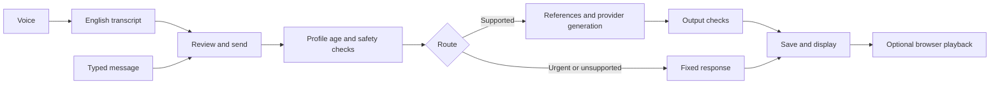

# LittleCare: Parenting Voice Assistant

Voice and text guidance for caregivers of children from birth through the second
birthday, with Kenya-focused information, source references and optional spoken
playback. Built with React, FastAPI, Firebase, faster-whisper and Qdrant, using a
configurable Gemini or Groq generation provider.

[Open the demo](https://littlecare.app) | [Release notes](RELEASE.md) |
[Changelog](CHANGELOG.md) | [Project structure](PROJECT_STRUCTURE.md)

The demo is for fictional profiles and non-personal example messages. A real
caregiver pilot requires reviewed provider processing arrangements and a matching
privacy notice; see [deployment modes](docs/deployment.md#deployment-modes).
The hosted app can be unavailable while stopped. The deployed commit and provider
account settings were not verified as part of this documentation update.

## What it does

- Verified sign-in, optional caregiver MFA, private child profiles and saved chats.
- English voice recording up to 30 seconds, editable transcripts and typed input.
- Age-aware guidance, follow-ups, expandable sources and Listen/Stop playback.
- Fixed urgent-care routing and local language checks before ordinary generation.
- Kenya vaccine education, source-linked timing information and emergency contacts.
- Optional feedback, versioned processing consent and account/data deletion.

Voice transcription stays fixed to English. The current development checkout
checks typed messages and edited transcripts locally and returns an
English/Kiswahili notice when it identifies unsupported input. Coaching remains
English-only. Recognized urgent reports retain their fixed referral.

Generated answers can contain errors. This system does not diagnose, prescribe,
interpret test results or provide a complete emergency assessment. Source links
and automated tests do not establish clinical validation.

## How it works



The default speech model is pretrained Whisper `base` on CPU with INT8. Speech
playback uses the browser's `speechSynthesis`. Coaching can use cautious general
information when reference coverage is incomplete. Details are in the
[caregiver workflow guide](docs/product-workflow.md).

## Local setup

Use Python 3.12 or 3.13 and Node.js 22. You need Firebase Authentication/Firestore,
a populated Qdrant collection and credentials for the enabled generation provider.
Commands below run from the repository root after cloning this repository.

For a new checkout on Windows PowerShell:

```powershell
python -m venv venv
.\venv\Scripts\python.exe -m pip install -r requirements-dev.txt
npm.cmd ci --include=optional
npm.cmd --prefix frontend ci --include=optional
Copy-Item .env.example .env
Copy-Item frontend/.env.example frontend/.env.local
```

For a new checkout on macOS/Linux:

```bash
python3 -m venv venv
./venv/bin/python -m pip install -r requirements-dev.txt
npm ci --include=optional
npm --prefix frontend ci --include=optional
cp .env.example .env
cp frontend/.env.example frontend/.env.local
```

Copy environment templates only for a new checkout; edit existing files instead
of replacing credentials. Configure Firebase, the reference collection and the
provider using the [complete setup guide](docs/setup.md) and
[environment template](.env.example). Use fictional data during development.

Start the backend and frontend in separate terminals:

```powershell
.\venv\Scripts\python.exe -m uvicorn backend.main:app --reload --host 127.0.0.1 --port 8000
npm.cmd run dev:frontend
```

```bash
./venv/bin/python -m uvicorn backend.main:app --reload --host 127.0.0.1 --port 8000
npm run dev:frontend
```

Wait for backend startup, then open http://localhost:5173/. API schemas are at
http://127.0.0.1:8000/docs. The first Whisper load may download model weights.
A liveness response does not verify external-service credentials or connectivity.

## Verification and evaluation

```powershell
npm.cmd run check
```

On macOS/Linux, use `npm run check`. This runs Python/frontend lint, backend and
frontend tests, audio-format tests and the frontend production build. CI also
runs the fixed child-danger and language development gates and the fixture-corpus
age check. These checks are not independent clinical or speech-accuracy studies.

The speech evaluator and document notes are ready. Accuracy on Kenyan caregiver
speech remains unmeasured; the generic JFK smoke test checks the tooling only.
Independent qualified review of the advice has not yet been completed. See the
[evaluation status guide](docs/evaluation.md) for evidence and limitations.

## Documentation

| Guide | Contents |
| --- | --- |
| [Setup](docs/setup.md) | Environment, Firebase, index preparation and service lifecycle |
| [Caregiver workflow](docs/product-workflow.md) | Profiles, chats, coverage, vaccines and playback |
| [API](docs/api.md) | Routes, authentication and conversation context |
| [Privacy and retention](docs/privacy.md) | Data flows, consent, deletion and provider boundaries |
| [Safety](docs/safety.md) | Input routing, language boundary and output checks |
| [Streaming](docs/streaming.md) | Provider failover, cancellation and timing |
| [Administration](docs/administration.md) | Feedback access and improvement workflow |
| [Deployment](docs/deployment.md) | Demo/pilot modes, containers, hosting and provider confirmations |
| [Hosting](docs/hosting.md) | Container verification, Azure workflows and domain operation |
| [Evaluation](docs/evaluation.md) | Recorded evidence, speech status and remaining validation |
| [Troubleshooting](docs/troubleshooting.md) | Common setup and runtime problems |

[Source preparation](data/README.md), [speech evaluation](eval/stt/README.md),
[working workflow](docs/working-workflow.md) and the
[performance report](PERFORMANCE_REPORT.md) provide supporting detail.

## License

Original project code uses the [ISC License](LICENSE). Reference materials,
source-derived summaries, dependencies and models have separate terms; see
[NOTICE](NOTICE). The code license does not grant rights to the reference corpus.
