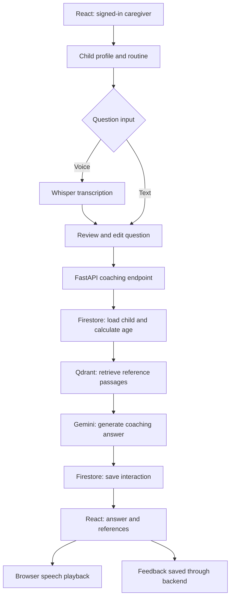

# Parenting Voice Assistant

A web application for caregivers of children from birth through 24 months.
Ask a question by voice or text, review developmental guidance with source
references, and listen to the answer.

[Release v0.1.0](https://github.com/Vinit-Rabadiya/parenting-voice-assistant/releases/tag/v0.1.0)
| [Release notes](RELEASE.md) | [Changelog](CHANGELOG.md)
| [Project issues](https://github.com/Vinit-Rabadiya/parenting-voice-assistant/issues)

## Features

- Email/password and Google sign-in, email verification, and optional TOTP MFA with backup authenticators.
- Child profiles with create, edit, and switch controls, birth date, calculated age,
  baseline milestone display, and optional additional milestones.
- English voice recording up to 30 seconds, transcription after Stop, and editable text.
- Typed questions and optional routine context such as feeding, bathing, and play.
- Qdrant retrieval from 184 selected source-linked passages and Gemini-generated guidance,
  with labelled general information when references are missing or incomplete.
- Reference titles, PDF page numbers, and source links displayed alongside answers.
- New answers reveal progressively after generation, with one Listen/Stop audio control
  and an automatic playback attempt after the text finishes appearing.
- Stored interactions and 1–5 helpfulness ratings, with optional reasons and comments
  submitted together through one Save feedback action. Historical Helpful/Not helpful
  records remain readable.
- Responsive interface with light and dark theme support.

The application supports developmental caregiver-child interaction. It is not
intended for medical diagnosis, treatment, or emergency assessment. Generated
answers can contain errors; references support review rather than guarantee every
claim. See [scope and availability](RELEASE.md#scope-and-availability).

## Planned baby-care coverage

The next scope expands beyond developmental activities to source-backed everyday
baby-care support for Kenya. The reference collection primarily covers birth through
the second birthday. Questions about children older than 24 months receive an
age-range notice instead of coaching. Planned topics
include feeding and nutrition, sleep, hygiene and clothing, crying and bonding,
growth and routine care, development and learning, vaccination, common concerns,
safety, outings/travel and childcare transitions. English remains the supported language.

This is a development plan, not a claim that all these topics are available in the
published release. The current branch uses the source-checked 184-passage everyday
collection; the original 106-passage collection remains available for rollback.
The larger candidate corpus is separate and is not activated. General vaccination
explanations and expected-effects information have WHO/UNICEF source links.
Current Kenya schedules, catch-up decisions and individual reactions are not
calculated in chat; these requests receive a clinic referral or source limitation.

Relevant baby-care statements and follow-ups use references when applicable and
label supplemental model knowledge as general information. Missing references or
a reference-service outage do not by themselves stop generation. General information
is not verified medical guidance. Unrelated requests are declined; urgent reports
and individual diagnosis or dose requests retain separate safety handling.

The topic inventory is listed above; task checklists are maintained in GitHub.
Reference work is
tracked in #76, vaccination in #100, common concerns in #102, and evaluation and
qualified review in #74, #78 and #79. Statements, follow-ups and helpful no-evidence
responses are tracked separately in #103. Medical diagnosis, prescribing and individualized
dose decisions remain outside scope. Published release notes retain their original scope.

## How it works

1. Sign in with a verified email. Complete the authenticator challenge if MFA is enabled or required.
2. Add or select a child profile.
3. Type a question, or record speech and review the transcript.
4. Select an optional routine and click **Get guidance**.
5. The backend loads the child's stored birth date, calculates age, retrieves
   reference passages, and sends the question, age, routine, and passages to Gemini.
6. The chat scrolls to the new answer. Its text appears progressively after the complete
   response arrives; reduced-motion preferences skip the animation. Audio attempts to
   start afterward. Use **Listen** if the browser blocks automatic playback, or the same
   button to stop or replay it. Saved answers do not replay automatically.
7. Review the references and submit feedback if desired.

The existing coaching model interprets clear spelling mistakes and informal follow-ups
in context, without a separate correction request. Original messages remain in history;
names, ages, dates, quantities and other important details are not automatically rewritten.
Ambiguous wording that changes the activity or safety needs a brief clarification.
Topic and age limits still apply.



Voice transcription runs locally through faster-whisper on CPU with INT8.
The default model is `tiny.en`; it is pretrained. Coaching uses retrieval-augmented generation. Speech output uses browser
`speechSynthesis`; audio is not synthesized by the backend.

## Technology stack

| Area | Implementation |
|---|---|
| Frontend | React 19, Vite 8, JavaScript, CSS |
| Backend | FastAPI, Uvicorn, Pydantic |
| Authentication | Firebase Web SDK and Admin SDK, verified email, TOTP |
| Storage | Cloud Firestore through backend Admin SDK |
| Speech recognition | faster-whisper and PyAV |
| Retrieval | Qdrant Cloud inference, all-MiniLM-L6-v2 embeddings |
| Coaching | google-genai SDK, configurable Gemini model |
| Speech playback | Browser Web Speech API |
| Checks | Pytest, Ruff, ESLint, Vitest, Node audio tests, GitHub Actions |

## Local setup

Commands below use Windows PowerShell from the repository root. For macOS/Linux,
use `venv/bin/python` in place of `.\venv\Scripts\python.exe` and `npm` in
place of `npm.cmd`.

### Prerequisites

- Python 3.12 or 3.13. Local verification used 3.13; backend CI uses 3.12.
- Node.js 22 and npm, matching frontend CI.
- A Firebase project configured for email/password, Google sign-in, and TOTP
  through Firebase Authentication with Identity Platform.
- A Firebase Admin service-account key and a default Firestore database.
- A Qdrant Cloud collection with cloud inference available.
- A Gemini API key and access to the configured model.
- Internet access for cloud services and the first Whisper model download.
- A browser supporting AudioWorklet and microphone access on localhost or HTTPS.

### 1. Install dependencies

```powershell
git clone https://github.com/Vinit-Rabadiya/parenting-voice-assistant.git
cd parenting-voice-assistant
python -m venv venv
.\venv\Scripts\python.exe -m pip install --upgrade pip
.\venv\Scripts\python.exe -m pip install -r requirements-dev.txt
npm.cmd ci --include=optional
npm.cmd --prefix frontend ci --include=optional
```

`requirements-dev.txt` includes the runtime and data-preparation requirements.
It also installs lint and test tooling; `requirements.txt` is the runtime install.
Root npm dependencies install the Husky development hooks.

### 2. Configure environment files

For a fresh checkout, copy the templates:

```powershell
Copy-Item .env.example .env
Copy-Item frontend/.env.example frontend/.env.local
```

If those files already exist, edit them rather than replacing your existing values.

Backend `.env`:

```dotenv
HOST=127.0.0.1
PORT=8000
FIREBASE_PROJECT_ID=your-firebase-project-id
FIREBASE_ADMIN_KEY_PATH=.secrets/firebase-admin.json
STT_MODEL=tiny.en
QDRANT_URL=https://your-cluster-url.qdrant.io
QDRANT_API_KEY=your-qdrant-api-key
QDRANT_COLLECTION=caregiver_guidance_everyday_v3
GEMINI_API_KEY=your-gemini-api-key
GEMINI_MODEL=gemini-3.5-flash-lite
GEMINI_FALLBACK_MODEL=gemini-3.8-flash
```

The documented Uvicorn command explicitly sets the bind address and port. The
`HOST` and `PORT` application settings do not override those command-line options.
If changing the backend port, also update the Vite development proxy target.

For verification, `npm.cmd run lint` runs only Python/frontend lint and
`npm.cmd test` runs only Python/frontend tests. `npm.cmd run check` retains the
full lint, test, and frontend-build sequence used by the pre-push hook.

Flash Lite is the primary coaching model. If it returns a quota error (429),
the backend tries the fallback once with identical context and references.
Leave `GEMINI_FALLBACK_MODEL` empty to disable fallback. Each model receives one
SDK attempt; other errors do not trigger fallback. Fallback availability depends
on its own quota and does not guarantee lower latency. Restart the backend after
changing these settings. The selected model is recorded in technical logs.

Place the Admin JSON key at the configured path. The service account must belong
to the configured Firebase project and have the required Firestore permissions.
The root `.env` and `.secrets/` directory are excluded from Git.

Frontend `frontend/.env.local`:

```dotenv
VITE_FIREBASE_API_KEY=your-firebase-web-api-key
VITE_FIREBASE_AUTH_DOMAIN=your-project-id.firebaseapp.com
VITE_FIREBASE_PROJECT_ID=your-project-id
VITE_FIREBASE_APP_ID=your-firebase-web-app-id
```

Use the Firebase Web App configuration, not the Admin private key. Restart the
backend after changing its environment settings and restart Vite after changing
frontend settings.

### 3. Configure Firebase and Firestore

In your Firebase project, enable Email/Password and Google authentication and add
`localhost` as an authorized domain. Enable Identity Platform support for TOTP.

Enable the Cloud Firestore API and create the default Firestore database in
production mode. Backend Admin SDK operations use service-account authorization;
the frontend does not write profiles or feedback directly.

Conversation listing requires the composite index recorded in
`firestore.indexes.json`: collection `conversations`, collection scope,
`child_id` ascending and `updated_at` descending. Create this index in the
Firestore console before using conversation history. The file records the index
definition; starting the backend does not create or deploy it.

Enable TOTP using the included administration script:

```powershell
node --env-file=.env scripts/enable-firebase-totp.mjs
```

To inspect TOTP configuration without changing it:

```powershell
node --env-file=.env scripts/check-firebase-auth.mjs
```

Email verification is required. Google sign-in uses Firebase's verified-email status;
the application never marks an email verified based only on the provider name.
MFA is optional for ordinary accounts. In **My Account**, enable an authenticator,
add a backup on a separate device, or turn MFA off after confirming sign-in.
Adding a first or backup authenticator requires confirming the current sign-in
before a setup key is created. If the QR code cannot be displayed, use the same
key for manual setup. Expired setup requires a fresh sign-in confirmation.
Cancelling setup clears its key and code without changing enrolled authenticators.

`AUTH_REQUIRE_MFA=false` is the default. Set it to `true` to require MFA globally.
The server-issued `mfa_required=true` claim and the `feedback_summary_admin=true`
administrator role also require MFA. Required MFA cannot be disabled through account
settings or bypassed by unenrolling directly with the provider. Protected application
data remains inaccessible until the required MFA sign-in is complete. Security
settings remain available for setup after verified first-factor sign-in.

Disabling MFA removes enrolled factors and invalidates existing sessions. Firebase
remains responsible for validating credentials; the backend verifies token validity,
revocation, current factor enrollment and applicable policy. Keep the deployed site
on HTTPS and restrict Firebase authorized domains to the deployed application.

For a lost authenticator, choose the backup in the sign-in challenge. If all factors
are lost, an administrator must independently verify account ownership before using
the recovery tool on a trusted workstation with Firebase Admin credentials:

```powershell
.\venv\Scripts\python.exe -m scripts.reset_account_mfa --uid ACCOUNT_UID
.\venv\Scripts\python.exe -m scripts.reset_account_mfa --uid ACCOUNT_UID --apply --identity-verified
```

The first command previews the operation. Recovery resets factors and revokes
sessions without removing mandatory MFA policy; affected accounts must enroll again
before accessing protected data. A password reset alone does not remove MFA.
The backend uses the Identity Platform administration API for enrollment status and
removal because the Python Admin SDK does not expose TOTP management. The service
account needs `firebaseauth.users.get` and `firebaseauth.users.update` permissions.

### 4. Prepare the reference index

The source inventory is in `data/sources.json`. Obtain the matching PDFs and place
them in `data/raw/pdfs/` using the filenames in that inventory. Source documents,
generated passages, and local credentials are not included in the repository.

An existing populated `caregiver_guidance_everyday_v3` collection can be used
without rebuilding. The 184-record collection was checked against its local
release fingerprint before activation. Restart the backend after changing
`QDRANT_COLLECTION`; an explicit value in `.env` overrides the default.
To roll back, set `QDRANT_COLLECTION=caregiver_guidance_minilm_v1` and restart.
Neither activation nor rollback deletes a collection.

For a new original 106-passage baseline index, run:

```powershell
.\venv\Scripts\python.exe -m scripts.prepare_rag_data
.\venv\Scripts\python.exe -m scripts.build_rag_passages
.\venv\Scripts\python.exe -m scripts.create_qdrant_collection --collection caregiver_guidance_minilm_v1
.\venv\Scripts\python.exe -m scripts.index_rag --collection caregiver_guidance_minilm_v1 --upload
```

These baseline commands do not build the expanded release. See
[the everyday release instructions](data/README.md#current-everyday-release)
for the selected release preparation and upload; do not upload the baseline into
the everyday collection. Original selections remain in `data/passage-selections.json`.

### 5. Start the application

Backend terminal:

```powershell
.\venv\Scripts\python.exe -m uvicorn backend.main:app --reload --host 127.0.0.1 --port 8000
```

Wait for **Application startup complete**. The first Whisper load may download
model weights; later loads use the local cache. Use one worker for local use to
avoid loading duplicate speech models.

Frontend terminal:

```powershell
npm.cmd run dev:frontend
```

- Application: http://localhost:5173/
- API documentation: http://127.0.0.1:8000/docs
- Health endpoint: http://127.0.0.1:8000/health/live

Vite forwards `/api/*` to the backend and removes the `/api` prefix. Production
hosting requires an equivalent HTTPS API routing arrangement; Vite's development
proxy is not included in the static build.

## API overview

Protected endpoints require `Authorization: Bearer <Firebase ID token>` and verified
email. TOTP is required when enrolled or enforced by policy. Backend routes are also mounted under
`/api/v1`. See the generated API documentation for request/response schemas.

| Method | Route | Purpose |
|---|---|---|
| GET | `/health/live` | Public liveness check |
| GET | `/me` | Verify account access |
| GET | `/me/security` | Read MFA status and policy for the current verified account |
| POST | `/me/security/mfa/disable` | Disable optional MFA after a recent full sign-in |
| GET | `/children` | List the authenticated user's profiles |
| POST | `/children` | Create a profile with name, date_of_birth, and optional milestones |
| PATCH | `/children/{child_id}` | Update an owned profile |
| POST | `/speech/transcribe` | Transcribe raw WAV audio |
| POST | `/conversations` | Create a conversation for an owned child profile |
| GET | `/conversations?child_id=...` | List a child's conversations, newest first |
| GET | `/conversations/{conversation_id}` | Read a page of conversation messages |
| DELETE | `/conversations/{conversation_id}` | Delete a conversation and its messages |
| POST | `/coach` | Submit child_id, question, optional routine and conversation_id |
| POST | `/coach/{interaction_id}/feedback` | Rate an interaction or a conversation answer |

Speech requests accept mono PCM16 WAV at 16 kHz, up to 30 seconds, with a
964096-byte body limit. One transcription runs at a time per server process;
concurrent requests receive HTTP 429. The response includes `text`,
`audio_seconds`, and `processing_seconds`.

Coaching responses include `interaction_id`, `answer`, `citations`,
`child_age_months`, and `processing_seconds`. Playback is handled in the browser.

When `conversation_id` is supplied, `/coach` verifies that the conversation belongs
to the authenticated account and selected child. It saves the submitted message
and checked response together, then returns `conversation_id` and `message_id`;
`interaction_id` is null. Without a conversation ID, the existing interaction
storage and feedback contract remain available. New conversation messages are not
duplicated in the interactions collection.

For conversation feedback, put the assistant's `message_id` in the existing
feedback route and include `conversation_id` with either `helpful` or an integer
`rating` from 1 to 5, plus optional `reasons` and `comment` in the JSON body.
Feedback is stored on that assistant message. Historical boolean ratings are not
converted to numeric scores. Helpfulness ratings do not establish clinical accuracy
and do not automatically train a model.

History reads accept a bounded `limit` and optional `before` document ID. For older
conversation pages, use the last returned conversation ID; for older message
pages, use the first returned message ID. Message pages are returned in reading
order. The interface can open saved conversations and display messages, sources,
audio controls, and feedback. Its composer uses one editable field for typed text
and speech transcription beneath the scrolling message thread. For conversation
requests, the backend loads at most six recent messages and selects up to three
complete answered exchanges within a 3,000-character budget. History helps
interpret follow-ups but is not reference evidence. Safety responses and
unsuccessful answers form a boundary: earlier turns are not carried past them.
Legacy interactions remain unchanged and are not yet included in the conversation
list.

Explicit short follow-ups such as "What else can I try?" include the recent
caregiver topic in reference search. A new standalone question keeps its own
search wording. No additional language-model rewrite call is used, and follow-ups
without a usable topic do not generate arbitrary guidance. Context is limited to
the selected conversation, not other chats or child profiles.
For requests for more ideas, the generation instructions distinguish new actions
from reworded or rearranged earlier advice. When references offer no further ideas,
the answer can use clearly labelled general information. Requests for explanation may clarify a previous suggestion
without presenting it as new advice. These are prompt-level controls and require
live response evaluation; automated prompt tests do not establish semantic novelty.

## Data handling

Firebase manages sign-in credentials. FastAPI verifies token validity and revocation,
email verification, current MFA enrollment and security policy before serving protected requests.

Profiles are stored under `users/{uid}/children/{id}`. New conversation messages,
references, timestamps, and feedback are stored under
`users/{uid}/conversations/{id}/messages/{id}`. Earlier standalone interactions
remain under `users/{uid}/interactions/{id}`.
Recorded audio is processed for transcription and is not deliberately persisted by
the application. Edited text is submitted only when **Get guidance** is selected.

Qdrant Cloud inference processes question text for retrieval; explicit follow-ups
can also include a recent caregiver message from the selected conversation.
Gemini receives the question, current calculated age, routine, retrieved reference
passages, and bounded recent conversation context when available.
Optional milestones are currently stored and displayed without affecting answer
generation. The conversation privacy disclosure explains that application history
is retained until the conversation, child profile, or account is deleted.
This is not a claim about third-party
provider or backup retention. Account deletion is available in account settings.
Before new processing, the interface displays a versioned notice and requires
explicit acceptance and confirmation of caregiver authority. The backend records
`consent_version`, server-generated `consent_at`, and `caregiver_authority` on
`users/{uid}`. Existing accounts without a current record must also accept; no
consent is inferred from previously stored profiles.

Authenticated `GET /privacy/consent` returns the current notice and acceptance
status. `POST /privacy/consent` accepts only the current version with both explicit
confirmations. The backend checks consent before profile creation/updates, new
conversations, coaching, feedback, and transcription. A missing or outdated record
does not block existing-data reads, deletion, or account settings. The notice
offers a read-only history view without acceptance.

Child names and dates of birth are retained for profile identification and
age-aware guidance; profile photos are not collected. Consent withdrawal controls
and broader privacy requirements still need separate work;
this flow alone does not establish legal compliance. Use fictitious profiles for
evaluation. Change the notice version when its processing terms change so an old
acceptance cannot silently authorise new terms.

Within the same open signed-in session, account navigation preserves the chat
workspace, selected conversation, draft, and loaded consent state in memory.
Recording and spoken playback stop when leaving chat. Confirmed account access
is not rechecked merely on window focus. Reloading the app or changing accounts
revalidates access; backend authentication and consent checks still apply to each
protected request. Data deletion resets the retained workspace and consent state.

Account settings offer separate **Delete my data** and **Delete my account**
actions. Authenticated `DELETE /me/data` removes application data, including child
profiles, conversations, feedback, legacy interactions, and the consent record,
while retaining the login account. Consent must be accepted again before new
processing. `DELETE /me` also deletes the login account. Both actions require a
sign-in completed within the last five minutes and remain available without
consent. Deletion affects application storage, not third-party provider records
or backup copies.

Coaching requests have a 60-second browser wait limit and a **Stop waiting**
control in place of the Send arrow. Submitted messages appear immediately in the
thread and clear the input; failed or cancelled requests leave a local message
with an unconfirmed-answer status. Any new draft stays in the input. Cancellation
does not automatically retry.
It stops the browser waiting, not necessarily server processing: the answer may
still be saved. Reopen the conversation before deciding whether to send again.
Sources are collapsed by default and can be expanded for inspection.

## Repository structure

```text
backend/
  api/dependencies.py       Shared service providers
  api/v1/endpoints/         Authentication, health, children, speech, coaching
  core/                     Configuration, Firebase initialization, token checks
  schemas/                  API request/response models
  services/                 Speech, retrieval, coaching, Firestore access
  main.py                   Application startup and route mounting
frontend/
  src/components/           Profiles, guidance workspace, recording, auth controls
  src/hooks/                Authentication, microphone, transcription lifecycle
  src/services/             Firebase and backend clients
  src/pages/                Landing, authentication, account screens
  public/audio/             AudioWorklet capture processor
data/
  sources.json              Source inventory and fingerprints
  passage-selections.json   Explicit passage selection rules
  evaluation/               Retrieval questions and recorded results
scripts/                    Data preparation, indexing, evaluation, checks
tests/                      Backend and frontend tests
.github/workflows/          CI configuration
CHANGELOG.md                Version history
RELEASE.md                  Release scope, requirements, and verification
```

## Verification

Run all configured checks:

```powershell
npm.cmd run check
```

This runs Ruff, Pytest, ESLint, Node audio-format tests, React tests, and the
production build. GitHub Actions runs backend checks and frontend lint/tests/build.

On 19 October 2026, 114 Python tests, 63 React tests, and 7 audio tests passed,
alongside both linters and the production build. Manual verification confirmed
answer generation and spoken playback. Audio-format tests do not measure speech
recognition accuracy or voice naturalness; full live-service and safety evaluation
are separate from the existing automated coverage.

## Troubleshooting

| Symptom | Check |
|---|---|
| Authentication temporarily unavailable | Backend internet access to Firebase; a healthy liveness endpoint does not verify cloud connectivity |
| Child profiles fail to load | Firestore API activation, default database creation, service-account permissions, and backend logs |
| Guidance generation fails | Qdrant/Gemini configuration, model access, quotas, and backend diagnostic messages |
| Coaching service temporarily busy (503) | Gemini reported service unavailability. Retry later; the application does not add automatic retries. |
| Coaching service request limit reached (429) | Check the configured project's Gemini quota and usage. Wait for the limit to reset or review the account plan before retrying. |
| Guidance could not be provided (`safety_blocked`) | The model service blocked a response or an answer matched an output guardrail. Only a clear replacement message is returned and stored, without supporting source cards. |
| Frontend reports connection refused | Backend is ready on port 8000 and both development servers are running |
| Microphone is unavailable | Site permission, supported browser, and localhost or HTTPS |
| Port 8000 is occupied | Stop the earlier backend process before starting another instance |

### Coaching output guardrails

After generation, `response_safety.py` checks common dose expressions, known
medication-instruction and diagnostic patterns, explicit conflicting age claims,
numeric citation bounds, model-generated links and source-record provenance.
Source cards must match the evidence records supplied to generation, including
their metadata. A blocked response is replaced before database storage and API
delivery. The frontend distinguishes `safety_blocked` from `no_evidence` and audio
playback reads only the returned replacement. Safety logs contain random request
identifiers, outcomes and reason codes, not conversation text.

These are limited deterministic guardrails, not comprehensive medical detection,
semantic grounding verification or expert clinical validation. The dose rule is
deliberately conservative and may block benign numerical references. Directly
negated medication instructions are exempted, but complex wording and unlisted
drugs or conditions can be missed. A passing check does not mean every claim is
supported by a source or that the answer is safe. Input danger-sign routing is
described separately below; broader scope classification remains outstanding. No additional model request
or change to the generation prompt is introduced.

The evaluation capture script applies the same checks. New records distinguish
`safety_blocked` outcomes and retain reason codes rather than the blocked generated
text. Earlier evaluation records remain unchanged; compare runs by code revision.

### Input danger-sign routing

`input_safety.py` checks English input after authenticated profile lookup and
before retrieval/generation. Recognized reports of breathing difficulty, inability
to feed, convulsions, unresponsiveness, dehydration, choking, injury and fever in
profiles under three completed calendar months return a fixed urgent-care referral.
The response uses `status: escalated` and `safety: escalate`; ordinary responses use
`safety: not_flagged`, which is not a medical safety clearance. Recognized reports
for aged-out managed profiles still receive the referral instead of only an age error.

Referral sources are predefined, not generated or retrieved by similarity. The
Kenya handbook's danger-sign passage supports its listed categories; WHO emergency
guidance and NHS accident guidance cover additional categories. Web references have
`pdf_page: null` rather than fabricated page numbers. Input safety logs contain reason
codes and random request identifiers, not symptom text. A failed interaction write
does not suppress the referral: `interaction_id` is then null and feedback is hidden.
Authentication and profile lookup remain required; this is not an emergency service.

These are conservative keyword/pattern rules with narrow negation and prevention
handling, not a validated clinical triage tool. They require explicit child/pronoun
context and can miss implicit subjects, spelling errors, other languages and
unfamiliar symptoms. Explicit Celsius readings of 38C or above are routed for
profiles under three completed months. Unitless and Fahrenheit readings, other
age-specific numeric thresholds and complex symptom descriptions are not covered
by that numeric rule. Historical or hypothetical readings can cause false alarms.
Fever routing uses the stored profile age, not an age inferred from free text. The
initial tests include 30 danger examples and 30 benign look-alikes, plus integration
checks; these are development examples, not an independently validated benchmark.
Professional review and the broader safety evaluation in #59 remain outstanding.

Sources:

- [Kenya Ministry of Health handbook, PDF page 45](https://www.health.go.ke/sites/default/files/2023-05/Mother%20Child%20Health%20Handbook%20MOH-FOR%20PRINT.pdf)
- [WHO paediatric emergency triage overview](https://www.who.int/publications/i/item/9789241510219)
- [NHS child accidents guidance](https://www.nhs.uk/baby/first-aid-and-safety/first-aid/what-to-do-if-your-child-has-an-accident/)

## Development roadmap

The current safety workstream, shared dataset, report commands and completion
checklist are documented in [eval/README.md](eval/README.md). Caregiver-support
messages bypass model generation and show Kenya-specific contacts only after an
explicit location selection. This supplements—not replaces—the input and output
checks described above.

Existing issues track retrieval quality and exact age handling, emergency triage
and response validation, privacy controls, conversation history, speech evaluation,
and production deployment. See [milestones](https://github.com/Vinit-Rabadiya/parenting-voice-assistant/milestones)
for planned work and [RELEASE.md](RELEASE.md) for the current release scope.

## API usage controls

My Account includes a read-only Usage section with counts, remaining allowances,
and reset times displayed in the browser's local time. Refresh usage retrieves
updated figures without consuming allowance. The authenticated `GET /me/usage`
endpoint reads only the current account's counters and disables response caching.

Authenticated accounts have configurable limits on coaching requests and new child profiles:

| Action | Per hour | Per day |
| --- | ---: | ---: |
| Coaching | 30 | 100 |
| Child profile creation | 5 | 20 |

Configure `COACH_HOURLY_LIMIT`, `COACH_DAILY_LIMIT`,
`CHILD_CREATE_HOURLY_LIMIT`, and `CHILD_CREATE_DAILY_LIMIT` as positive integers
and restart the backend after changing them. Hourly limits use fixed clock-hour
windows; daily limits reset at midnight in Africa/Nairobi (UTC+3).

Counters are reserved atomically in Firestore under
`users/{uid}/usage/{action}`, so server processes share the same limits.
Accepted attempts count even when no evidence is found or later processing fails.
Recognized safety concerns receive the fixed safety response without consuming
coaching quota. Reading, updating, and deleting existing profiles or history are
not subject to these new limits.

An exhausted limit returns HTTP 429 with a numeric `Retry-After` header.
The interface displays the waiting interval and does not automatically resend.
If counters cannot be checked, protected requests return HTTP 503 rather than
bypassing the limit. Limit events exclude account identifiers and message text.

These controls are not external-provider quota tracking or a billing guarantee.
Fixed windows allow bursts around reset boundaries. Deleting account data also
deletes its counters; these limits do not prevent account recreation or replace
broader abuse protection.

## Aggregate feedback administration

Administrator accounts open a dedicated **Administrator dashboard** after sign-in,
with rating and reason panels loaded directly on the page. **Refresh feedback**
reloads the report. Exact category counts appear from the first eligible response;
an empty state appears when there is no eligible feedback.
They do not enter the caregiver workspace
or create child profiles, start coaching conversations or record questions.
Caregiver accounts keep the existing chat workflow. Backend authorization requires the
boolean `feedback_summary_admin` custom claim in a verified Firebase token, in
addition to verified email and completed authenticator sign-in. The permission
must also still be present on the current provider account record; an older
token alone cannot retain a removed administrator role. MFA is mandatory for
these accounts and cannot be disabled through account settings.
There is no endpoint for granting permission or opening other accounts' chats.

There is no separate administrator password or public administrator registration.
Use a dedicated account, register or sign in through the normal page, verify its
email and enable MFA in My Account. A trusted system operator then grants the
role using the command below. After signing out and back in with the authenticator,
the dashboard opens automatically and loads a read-only view of grouped
helpfulness ratings and reason categories, used to identify improvements for
separate investigation and evaluation. It does not edit models, manage other
accounts or display private conversations and child profiles.

The `/me` response supplies the server-checked account role used for navigation.
Caregiver feature APIs also reject administrator sessions; hiding controls alone
does not enforce the separation. **My Account → Settings** remains available for
the administrator's own security and account deletion. Caregiver consent and usage
controls are hidden there. Existing personal data from before a role change is
retained until the account owner deletes it; changing role does not delete records.

The overview contains counts for numeric ratings, optional reason categories and
separate historical Helpful/Not helpful feedback. **Written feedback** shows up to
50 of the most recent shared comments, with their ratings and selected reasons.
It does not attach questions, answers, transcripts, names, birth dates, account IDs,
individual timestamps or conversation links. Comments contain the text supplied
by the caregiver; both the notice and comment field explain administrator access
and ask caregivers to avoid names and private details. There are no account filters,
exports, totals, averages or conversation drill-down. Each answer's saved feedback contributes once,
including multiple answers rated by the same caregiver. Editing feedback replaces
that answer's previous contribution. There is no minimum number of caregivers;
counts include categories with one response. A response may select more than one
reason, so reason counts should not be added together as a response total.

Notice version `2026-10-26.2` explains this use. A contribution is eligible only
when its account accepted the current notice and its recorded time is at or after
acceptance. Old feedback is not repurposed automatically. An intentional edit after
acceptance is a new contribution. Numeric ratings are never inferred from old
boolean ratings. Earlier notices did not authorize written-comment review, so
accepting the new notice does not expose comments recorded before acceptance.
The former per-message `review_status` field is no longer created or
returned; historical fields need no migration and do not grant review access.

The service projects only feedback rating, helpfulness, reason, comment and recorded-time
fields, plus message role. It recomputes from retained source records without
creating a separate feedback copy or training dataset. After an edit or completed deletion, the
next summary reflects the remaining eligible contributions. It scans at most
10,000 documents per collection group and 500 accounts, with a ten-second
processing budget and bounded individual database calls. Failure, timeout or a
limit produces an unavailable response, never partial counts or invented zeroes.
At larger scale, use a separately reviewed aggregate pipeline rather than raising
limits silently. No summary scan runs during coaching, so this adds no model calls
or reference retrieval to caregiver requests.

### Grant or revoke access

Run these commands only on a trusted server with the existing Firebase Admin
credentials. Replace `ACCOUNT_UID` with the intended account's Firebase UID.
Preview does not connect to Firebase or change an account:

Find the intended account's UID under **Firebase Console → Authentication → Users**.
Replace `ACCOUNT_UID` below with that UID; the example is not an account to create.

```powershell
.\venv\Scripts\python.exe -m scripts.set_feedback_admin --uid ACCOUNT_UID --grant
.\venv\Scripts\python.exe -m scripts.set_feedback_admin --uid ACCOUNT_UID --grant --apply
```

Revoke access with:

```powershell
.\venv\Scripts\python.exe -m scripts.set_feedback_admin --uid ACCOUNT_UID --revoke --apply
```

The command preserves unrelated custom claims and revokes existing sign-in
sessions. Sign in again after a successful change. If session revocation fails,
retry the command; do not assume revocation is complete. No real account is
promoted by setup or automated tests. Application permission does not grant cloud
console access; protect production service credentials and cloud IAM separately.
See [Firebase custom claims](https://firebase.google.com/docs/auth/admin/custom-claims)
and [session revocation](https://firebase.google.com/docs/auth/admin/manage-sessions).

### Lost authenticator recovery

The feedback-overview permission does not grant account-recovery powers. Recovery
is a separate trusted operator action, after independently verifying the account
owner's identity. The existing command previews without changing an account:

```powershell
.\venv\Scripts\python.exe -m scripts.reset_account_mfa --uid ACCOUNT_UID
.\venv\Scripts\python.exe -m scripts.reset_account_mfa --uid ACCOUNT_UID --apply --identity-verified
```

Applying recovery removes enrolled authenticators and invalidates existing sessions.
Mandatory MFA policy, including administrator policy, is retained. The recovered
administrator must enroll and complete MFA again before opening grouped feedback.

### Improvement workflow without private chats

1. Review rating and reason counts for improvement signals; a low rating alone
   does not establish an incorrect answer.
2. Open an improvement issue using only the category and a separately written
   test question. Shared comments may inform the investigation, but do not copy
   a caregiver's question, answer, private details or comment into a public issue.
3. Reproduce the concern with the existing evaluation tools. Record the test
   case, original sources, corpus fingerprint, actual model/prompt configuration
   and evaluation split. Keep tuning separate from held-out evaluation.
4. Review a source, retrieval or prompt correction and compare the same
   development example before and after. Do not describe source checks or automated
   evaluation as professional validation; that review has not been obtained.
5. Link the correction and evaluation evidence in the improvement issue, then
   close that issue when its acceptance criteria are met. Do not mark an
   individual private conversation reviewed or train automatically from ratings.

Administrator review identifies problems to reproduce with separate evaluation
cases. Compare a correction or candidate model on the same cases before adoption.
This workflow does not fine-tune Gemini or the speech model, and written comments
alone are not reference transcripts or validated training examples.

A synthetic demonstration is documented in
[the coaching evaluation review](data/evaluation/coaching-quality-review.md#aggregate-feedback-improvement-example).

## Deployment security

The API verifies Firebase sessions, verified email, account ownership and applicable
MFA policy. Private API responses use `Cache-Control: no-store`. Incoming JSON bodies
are limited to 64 KiB and other bodies to 1 MiB, with a 15-second upload deadline;
audio validation also enforces the existing 30-second recording limit. The upload
deadline does not limit model generation. Provider error descriptions are excluded
from application diagnostics.

Before public deployment:

- Serve the built frontend and API through HTTPS. Configure the hosting platform's
  security headers, request throttling, concurrency limits and trusted proxy settings.
  Vite's development and preview servers are not production hosting.
- Keep backend API keys and Firebase Admin credentials in the host's secret store.
  Never include them in frontend variables, public files, source control or images.
- Retain Firestore rules that deny direct client access. The backend uses server
  credentials, so its IAM permissions must be limited separately.
- Restrict the public Firebase browser key to the Firebase APIs required by the app;
  keep Gemini on a separate private key. Add only the intended authentication domains.
- Enable repository secret scanning and push protection where available.
- Confirm the model provider's data-handling terms for the configured account and
  service tier before processing personal information. Gemini's unpaid-service terms
  prohibit submitting sensitive, confidential or personal information; see the
  [Gemini API terms](https://ai.google.dev/gemini-api/terms).

Dependency audits and automated tests do not replace checking the deployed host,
cloud permissions and provider account configuration.

### Production configuration

Local development defaults to `APP_ENV=development`. Production startup requires
`APP_ENV=production`, an explicit comma-separated `ALLOWED_HOSTS` list of API host
names, and `GEMINI_PAID_SERVICES_CONFIRMED=true`. Host names must not include a URL
scheme, port or wildcard. Production requests to an unrecognized host are rejected;
HTTP requests to an allowed host redirect to HTTPS.

Set the paid-services confirmation only after checking active Cloud Billing and the
applicable provider terms. This setting records an operator confirmation; it does
not query billing or change how Google processes data. Free-tier development must
use fictional, non-personal examples. The confirmation defaults to false.

When HTTPS terminates at a reverse proxy, configure Uvicorn to trust forwarded
headers only from that proxy. Incorrect proxy settings can cause redirect loops.
The public hostname and proxy addresses depend on the selected hosting platform.

On Google-managed hosting, `FIREBASE_USE_ADC=true` uses the attached service account.
Unset `FIREBASE_ADMIN_KEY_PATH` in that mode. Other hosts can mount a private key
from a secret store using the existing key-path setting. Do not grant the runtime
service account Owner or Editor merely to inspect cloud settings: use an operator
account for administration. Runtime access needs Firestore data permissions and
the Firebase Authentication permissions used for reading accounts, updating MFA
and deleting accounts; review these separately from operator privileges.

The checked-in `firestore.rules` denies direct client access, and `firebase.json`
maps that rules file and the existing indexes. The backend remains responsible
for account isolation because server credentials bypass Firestore rules. Changes
to these local files are not published automatically. `.dockerignore` excludes
environment files, common private-key files, local credentials and logs from the
container build context.

CI includes a Gitleaks scan of new commits with redacted findings. It uses a pinned
release with checksum verification, does not post comments or upload reports,
and needs no secret-scanning subscription. This detects leaked secrets after a
push; it does not replace before-push protection or the cloud credential review.

## License

Original project code is licensed under the [ISC License](LICENSE).
Third-party reference materials, source-derived summaries, dependencies and models
remain subject to their own terms; see [NOTICE](NOTICE) for attribution and reuse
conditions. The code license does not grant reuse rights for the reference corpus.
