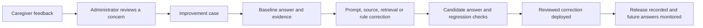

# Feedback to better coaching answers

[Documentation home](../README.md#documentation) · [Administrator access](administration.md).

## What feedback changes

The system already collects a rating, optional reasons and an optional shared
comment for an answer. The administrator overview shows eligible feedback without
the caregiver's question, answer, identity or child profile. Feedback points to a
problem worth investigating; a low helpfulness rating is not proof of a factual
or safety error.

The new **Answer improvement cases** workspace closes the review-record loop:

The dashboard records this process. It does not train a model, run model
evaluation, edit prompts or deploy code when a status button is pressed. An
operator still makes the versioned correction, runs the appropriate evaluation
and checks the actual deployment. The record identifies that work and its
evidence; the correction affects future answers only when it is applied to the
running system.

Gemini/Groq model weights do not change from these ratings. The application can
improve the instructions and references supplied to its existing model, the way
references are retrieved, and the checks applied to answers. Feedback is not
automatically inserted into future prompts or treated as trusted training data.

## Dashboard workflow

Use an existing administrator account with verified email, the current role and
completed MFA. The existing [role setup](administration.md#grant-or-revoke-access)
applies. A role does not grant access to another administrator's cases.

1. Inspect the existing rating/reason overview and shared comments. Choose a
   recurring or important concern. Do not infer how many distinct caregivers
   contributed from per-answer counts.
2. Choose **New improvement case**. Select the feedback category, describe the
   **Scenario** and expected answer behavior, and enter a date of birth for the
   scenario within the supported age scope. The evaluation date defaults to today
   and can be changed to match the case. Confirm that the case contains no caregiver
   identifiers or private chat text. Nothing is copied automatically from a caregiver
   conversation or comment.
3. Save the investigation. Open **Test a fix** when you have a correction to
   review. Record the correction area, explanation and
   commit/PR reference. Capture a baseline and a candidate answer using the same
   question, age and intended conditions. Use each answer's **Evidence
   and scores** to record the actual model, prompt revision, corpus revision and
   evaluation report reference. **Save review draft** keeps partial evidence.
4. In the same section, score both answers on source support, helpfulness, age fit, clarity
   and safety boundaries using the existing [1–5 review rubric](../data/evaluation/coaching-quality-review.md). Record issue resolution,
   source/age/safety review, regression results and evaluation notes. Use real
   captures and checks; a typed reference is not automatically verified.
5. Choose **Record successful evaluation**. The API requires complete captures,
   provenance, scores and all checks. Candidate source-support, age-fit and
   safety scores cannot be lower than the baseline. The status is **Evaluation
   recorded**, meaning the administrator's evidence and attestations are saved;
   it is not clinical approval or an independent automated evaluation result.
   Candidate source-support, age-fit and safety scores must be at least 4/5 when
   applicable, a development review policy rather than a clinical guarantee.
   If no references were supplied, mark source support explicitly not applicable
   with a reason instead of inventing a score; the other checks still apply.
6. Apply the reviewed correction through the normal source/code review and
   deployment process. After checking the running revision, open **Release record**, enter the full
   40-character deployed commit and release notes, confirm deployment and choose
   **Record release**. This records the operator's observation; it does not
   contact GitHub/Azure or deploy anything.
7. Monitor subsequent feedback as new review signals. Cumulative dashboard counts
   are affected by editing and deletion and are not a causal before/after study.
   Use paired evaluation cases and a separate held-out set to assess changes.

## What each concern can lead to

| Feedback category | Example investigation | Possible reviewed correction |
| --- | --- | --- |
| Unclear | An answer is hard to understand | Clearer prompt instructions or more actionable source text |
| Repeated advice | A synthetic follow-up repeats earlier actions | Improve follow-up instructions or context handling |
| Did not answer | The answer misses the request | Correct intent handling, retrieval wording or source coverage |
| Not age appropriate | The captured advice does not fit the resolved age | Review age resolution, passage eligibility and output safeguards |
| Other concern | Reproduce and characterize the problem first | Choose an appropriate content, retrieval, prompt or rule change |

For example, a repeated-advice signal can motivate a follow-up request for more
ideas. Capture the old response, change the relevant coaching instructions,
capture the candidate response, and review whether it adds an appropriate distinct
action. A recorded helpfulness change from 2/5 to 4/5 is a reviewer judgment on
that example, not a percentage accuracy gain or a population result.

## Record integrity and privacy

- New cases begin as **Investigating**. A release cannot be recorded directly
  from investigation; the evaluation stage is required first.
- Reviewed content is locked while evaluation/release is recorded. Under **Case
  actions**, use **Reopen investigation** before changing it. Reopening clears check attestations and
  release confirmation so old checks do not silently approve new content.
- Every save/delete includes an expected version. A stale browser tab receives
  a conflict instead of overwriting another update. Refresh and open the latest
  case before retrying. This is a versioned current record, not an immutable
  history of all earlier edits.
- Under **Case actions**, **Download saved review record** exports the last saved JSON record for the
  administrator's own review/document work. It does not export original caregiver
  questions or attach account identity. Downloaded copies remain separate files
  and are not recalled by in-app deletion.
- Cases live under `users/{administrator_uid}/feedback_improvements/{id}`. List,
  cursor, update and delete operations stay within the authenticated account.
  Lists are paginated; no unbounded cross-account scan is added.
- Case deletion and the existing Delete my data/Delete my account cleanup remove
  the relevant application records. There is no automatic expiry. The existing
  caregiver feedback eligibility and deletion rules are unchanged. Synthetic
  case scores are not counted as caregiver feedback.

Administrators must still check their own entered content. The privacy checkbox
records the administrator's confirmation. No new permission
to inspect caregiver chats or send those chats to a provider is introduced.

## Latency and evaluation limits

The improvement workspace loads only in the administrator view. Its reads and
writes, feedback review, comparison and release bookkeeping do not run on the
caregiver coaching path. There is no extra provider request or Firestore lookup
in ordinary chat because of this workflow. A later prompt/content correction
can still change generation time and must be measured before adoption.

The workflow validates record completeness and stage transitions. It does not
verify that an entered report exists, rerun the stated regressions or independently
confirm deployment. Review scores and checkboxes are attributable to the signed-in
administrator's workspace, not professional validation of the whole system.
Independent expert review and representative caregiver evaluation remain separate.
