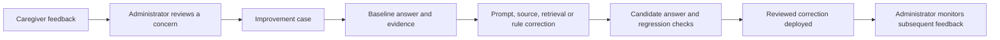

# Feedback to better coaching answers

[Documentation home](../README.md#documentation) · [Administrator access](administration.md).

## What feedback changes

The system already collects a rating, optional reasons and an optional shared
comment for an answer. The administrator overview shows eligible feedback without
the caregiver's question, answer, identity or child profile. Feedback points to a
problem worth investigating; a low helpfulness rating is not proof of a factual
or safety error.

The **Answer improvement cases** workspace lets administrators save concerns from
caregiver feedback. Project maintenance uses those concerns to guide corrections:

The dashboard records the concern. A project maintainer makes the versioned
correction, runs the appropriate evaluation, and checks the deployment through
the regular development workflow. The correction affects future answers when
it is applied to the running system.

Gemini/Groq model weights do not change from these ratings. The application can
improve the instructions and references supplied to its existing model, the way
references are retrieved, and the checks applied to answers. Feedback is not
automatically inserted into future prompts or treated as trusted training data.

## Dashboard workflow

Use an existing administrator account with verified email, the current role and
completed MFA. The existing [role setup](administration.md#grant-or-revoke-access)
applies. A role does not grant access to another administrator's cases.

1. Inspect the existing rating/reason overview and shared comments. Choose a
   recurring or important concern. Do not infer how many distinct caregivers
   contributed from per-answer counts.
2. Choose **Investigate** beside a reported reason to start a new case with its
   category selected. You can also choose **New improvement case** and select the
   feedback category yourself. Describe the
   **Scenario** and expected answer behavior. Include a test age in the scenario
   if it matters to the concern. Confirm that the case contains no caregiver
   identifiers or private chat text. Nothing is copied automatically from a caregiver
   conversation or comment.
3. Choose **Save investigation** to keep the concern in the dashboard.
4. Monitor subsequent feedback as new review signals. Cumulative dashboard counts
   are affected by editing and deletion and are not a causal before/after study.
   Use paired evaluation cases and a separate held-out set to assess changes.

## What each concern can lead to

| Feedback category | Example investigation | Possible reviewed correction |
| --- | --- | --- |
| Unclear | An answer is hard to understand | Clearer prompt instructions or more actionable source text |
| Repeated advice | A synthetic follow-up repeats earlier actions | Improve follow-up instructions or context handling |
| Did not answer | The answer misses the request | Correct intent handling, retrieval wording or source coverage |
| Not age appropriate | The captured advice does not fit the resolved age | Review age resolution, passage eligibility and output safeguards |
| Other concern | Reproduce and characterize the problem first | Choose an appropriate content, retrieval, prompt or rule change |

For example, a repeated-advice signal can motivate a follow-up request for more
ideas. Capture the old response, change the relevant coaching instructions,
capture the candidate response, and review whether it adds an appropriate distinct
action. A recorded helpfulness change from 2/5 to 4/5 is a reviewer judgment on
that example, not a percentage accuracy gain or a population result.

## Record integrity and privacy

- New cases are saved as **Investigating**. Existing cases with a recorded
  evaluation or release are available as read-only archived cases.
- Every save/delete includes an expected version. A stale browser tab receives
  a conflict instead of overwriting another update. Refresh and open the latest
  case before retrying. This is a versioned current record, not an immutable
  history of all earlier edits.
- Under **Case actions**, **Download saved review record** exports the last saved JSON record for the
  administrator's own review/document work. It does not export original caregiver
  questions or attach account identity. Downloaded copies remain separate files
  and are not recalled by in-app deletion.
- Cases live under `users/{administrator_uid}/feedback_improvements/{id}`. List,
  cursor, update and delete operations stay within the authenticated account.
  Lists are paginated; no unbounded cross-account scan is added.
- Case deletion and the existing Delete my data/Delete my account cleanup remove
  the relevant application records. There is no automatic expiry. The existing
  caregiver feedback eligibility and deletion rules are unchanged. Synthetic
  case scores are not counted as caregiver feedback.

Administrators must still check their own entered content. The privacy checkbox
records the administrator's confirmation. No new permission
to inspect caregiver chats or send those chats to a provider is introduced.

## Latency and evaluation limits

The improvement workspace loads only in the administrator view. Its reads and
writes, feedback review, comparison and release bookkeeping do not run on the
caregiver coaching path. There is no extra provider request or Firestore lookup
in ordinary chat because of this workflow. A later prompt/content correction
can still change generation time and must be measured before adoption.

The app validates the information required to save a concern. Evaluation and
deployment verification are part of the project maintenance workflow.
