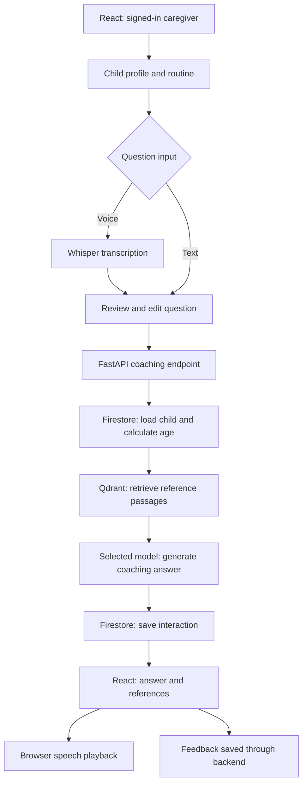

# Caregiver workflow and coverage

[Documentation home](../README.md#documentation). Commands run from the repository root.

## Features

- Email/password and Google sign-in, email verification, and optional TOTP MFA with backup authenticators.
- Child profiles with create, edit, and switch controls, birth date, calculated age,
  baseline milestone display, saved milestone context, and optional private health-and-care notes.
- English voice recording up to 30 seconds, transcription after Stop, and editable text.
- Typed questions and optional routine context such as feeding, bathing, and play.
- Guidance defaults to Kenya without a country picker; relevant safety responses include Kenya support contacts.
- Source-checked Kenya vaccination education covers routine visit ages, vaccine purposes
  and common side effects. Clinics confirm individual due doses and regional eligibility.
- **Understand vaccines** opens a searchable education area beside the selected child's
  chat: booklet abbreviations, common questions, routine ages, original sources and optional listening.
  **Open in new chat** prepares an editable question in a fresh conversation.
- Qdrant retrieval from 216 selected source-linked passages and age-aware guidance with a configurable model provider.
  Baby-care questions can also receive guidance when references are missing or incomplete.
- Reference titles, PDF page numbers, and source links displayed alongside answers.
- Complete checked answers appear immediately, with one Listen/Stop audio control
  and a caregiver-controlled automatic playback setting.
- Stored interactions and 1–5 helpfulness ratings, with optional reasons and comments
  submitted together through one Save feedback action. Historical Helpful/Not helpful
  records remain readable.
- Responsive interface with light and dark theme support.

The application supports developmental caregiver-child interaction. It is not
intended for medical diagnosis, treatment, or emergency assessment. Generated
answers can contain errors; references support review rather than guarantee every
claim. See [scope and availability](../RELEASE.md#scope-and-availability).

## Baby-care coverage

The current application covers Kenya, English, and children from birth through
the second birthday. It accepts questions, everyday statements and follow-ups.
References cover feeding and nutrition, sleep, bathing and clothing, oral care,
crying and bonding, growth records, development and learning, safety, outings,
childcare transitions and caregiver support.

Selected common-concern references cover milk regurgitation, vomiting and
diarrhoea, fever, coughs and colds, nappy-area irritation, teething, stool changes,
newborn yellowing and developmental concerns. Age restrictions, practical
precautions and professional-assessment boundaries accompany these selections.
Kenya vaccination information uses its separately checked schedule and sources;
clinics confirm individual due doses and regional eligibility.

The active collection contains 216 passages with 45 source entries across
42 original URLs. The previous 184-passage collection remains available for
rollback. Source-linked basic-care facts are also available locally to support
selected answers. Broader clinical candidate packs remain excluded.

Missing references do not by themselves prevent an in-scope answer. Unrelated
requests are declined, and urgent reports take priority over generation.
Diagnosis, prescribing and individual dose decisions remain outside scope.
See [source preparation and evaluation](../data/README.md) for the source inventory,
coverage review and verification records. Published release notes retain the
scope of their tagged release.

### Understand my baby's vaccines

After selecting a child, choose **Understand vaccines** in the chat heading. Search
names such as BCG, OPV/IPV, pentavalent, PCV, rotavirus, MR, TCV, malaria and yellow
fever, or explore questions about immunity, multiple vaccines, autism claims,
unclear booklet entries and general side effects. Each explanation links to its
original WHO, UNICEF or Kenya Ministry of Health sources. **Listen to explanation**
uses the existing browser speech controls and stops when changing cards or closing
the area. Browser audio availability varies; the text remains available.

This area provides general education for caregivers of babies aged 0–24 months.
It does not interpret a baby's symptoms, infer vaccination history, calculate
catch-up doses or determine eligibility. The clinic uses the booklet to confirm
individual doses and appointments. **Open in new chat** starts a fresh conversation
with an editable question; it never sends automatically or appends to the existing
conversation. An unsent draft must be sent or cleared first. Consent remains required
for coaching, and existing saved conversations remain available in history.

**By age: days, weeks and months** shows the routine Kenya programme from birth
through the second birthday. The Days view covers birth and exact equivalents of
week visits (6/10/14 weeks = 42/70/98 days). The Weeks view keeps those official
week labels. Later visits stay in calendar months (6, 7, 9, 18 and 24), available in
Months; no fixed 30-day or four-week month conversions are used. Each vaccine card
also shows its routine timing while that timing check is current. Malaria and
yellow fever remain conditional on local programme/risk-area eligibility. These
ages are not an individual due-dose list or a catch-up plan; products and records
must be checked by the clinic. The source label shows the reporting year separately
from the check date. See [timing source checks](../data/evaluation/vaccine-schedule-learning-source-review.json).

The explanations and their styles load only after the parent opens this area.
Reading and searching make no application API, Firestore, Qdrant or model calls.
The existing coaching path is used only if a parent sends a prepared question.
Content is held back after its 90-day source-check window (or before its recorded
check date), with an original-source link available instead. Updating the checked
date requires rechecking the claims and links; it is not an automatic freshness stamp.
See [education source checks](../data/evaluation/vaccine-learning-source-review.json).

## How it works

1. Sign in with a verified email. Complete the authenticator challenge if MFA is enabled or required.
2. Add or select a child profile.
3. Type a question, or record speech and review the transcript.
4. Select an optional routine and click **Get guidance**.
5. The backend loads the child's stored birth date, calculates age, retrieves
   reference passages, and sends the message, resolved age, routine, selected
   milestones, enabled care notes, bounded conversation context and passages to the selected model provider.
6. The chat scrolls to the new answer and displays the complete text immediately.
   When automatic playback is enabled, audio attempts to start without a word-reveal delay.
   Use **Listen** if the browser blocks automatic playback, or the same
   button to stop or replay it. Saved answers do not replay automatically.
7. Review the references and submit feedback if desired.

Chat startup uses `GET /me/startup` to check the current login, email, revocation
and MFA policy once, then return the current consent notice and owned profiles.
The first message starts its conversation within `POST /coach`, avoiding a separate
conversation-creation round trip. The client supplies a UUID so a cancelled wait
can still be associated with the same conversation; an existing ID cannot be overwritten.
History loads in the sidebar without blocking the composer. Up to three recently
used child workspaces retain drafts and loaded history in memory, scoped to the
signed-in account; deletion, consent changes and logout discard the affected state.
Account settings reuse a display-only security summary for at most 60 seconds.
Explicit verification refresh and MFA changes invalidate it. The backend always
validates JWTs and enforces MFA, with short reuse of remote caregiver security
checks as described below. Opening settings does not force a Firebase token refresh.
The browser reuses that response in memory while opening chat instead of fetching
consent and profiles again. Administrators receive neither. Data deletion refreshes
startup; a changed notice invalidates the consent view. Profile creation, edits and
deletion update the workspace's profile list, including when its controls remount.
Conversation history remains a separate authenticated request.

Each saved conversation has an address such as `/chat/<conversation-id>`.
Chat titles in history are links: right-click to open in a new tab or copy the
address, or use Ctrl/Cmd-click or the middle mouse button. A normal click opens
the conversation within the existing workspace.
Refreshing or opening that address selects its child profile after checking access.
Browser Back and Forward restore chats; switching within the app does not reload
the page or request another generated answer. These addresses require sign-in
and do not grant other accounts access to conversations.

For questions covered by the selected local basic-care references, coaching uses
those references directly rather than making a vector search whose results would
be discarded. Other topics retain age-filtered retrieval. Metadata-only request
timings include token verification, account security and consent. `X-Request-ID`
correlates these with coaching stages, and `Server-Timing` reports server duration.
Logged routes come from a fixed set; identifiers, query strings, tokens and messages
are excluded. Response time now includes authentication and profile lookup, while
browser/network overhead remains outside that server measurement.

An age-range refusal retains its caregiver request so an explicit correction can
resume the same question at the corrected age. Requests to repair an irrelevant
answer also retain the original question. Other safety boundaries still stop
conversation context, and the restored question is checked for domain and individual
medical-assessment restrictions before generation.

In **My Account → Settings**, turn **Read replies automatically**
on or off. It defaults to on and is remembered separately for each account in the
current browser. Manual Listen/Stop works with either choice. Enabling it applies
to new replies rather than replaying existing history; navigation, recording,
child changes and logout still stop playback. Turning it off stops an automatic
playback attempt without disabling manual Listen. Browsers may still block
automatic audio until a direct interaction.

The preference is stored only in browser storage; it adds no backend request or
model call and does not change speech models. It survives ordinary sign-out and
sign-in but is cleared when saved app data or the account is deleted in this
browser. If storage is blocked, the choice applies only to the current tab and
Settings explains that it could not be saved. An unreadable saved preference
leaves automatic playback off while manual Listen remains available.

The existing coaching model interprets clear spelling mistakes and informal follow-ups
in context, without a separate correction request. Original messages remain in history;
names, ages, dates, quantities and other important details are not automatically rewritten.
Ambiguous wording that changes the activity or safety needs a brief clarification.
Topic and age limits still apply.

Voice transcription runs locally through faster-whisper on CPU with INT8.
The default model is `base`; it is pretrained. Coaching uses retrieval-augmented generation. Speech output uses browser
`speechSynthesis`; audio is not synthesized by the backend.

## Technology stack

| Area | Implementation |
|---|---|
| Frontend | React 19, Vite 8, JavaScript, CSS |
| Backend | FastAPI, Uvicorn, Pydantic |
| Authentication | Firebase Web SDK and Admin SDK, verified email, TOTP |
| Storage | Cloud Firestore through backend Admin SDK |
| Speech recognition | faster-whisper and PyAV |
| Retrieval | Qdrant Cloud inference, all-MiniLM-L6-v2 embeddings |
| Coaching | Configurable Gemini or Groq provider, shared prompts and response checks |
| Speech playback | Browser Web Speech API |
| Checks | Pytest, Ruff, ESLint, Vitest, Node audio tests, GitHub Actions |
