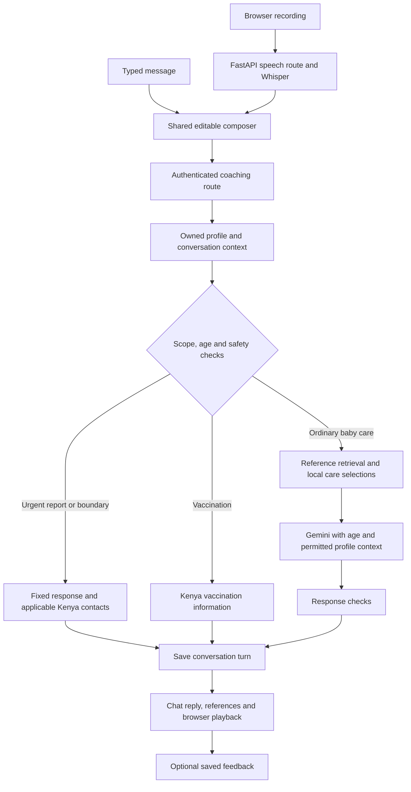

# Caregiver conversation workflow

Current release: [v0.2.0](../RELEASE.md). Hosted application:
[littlecare.app](https://littlecare.app). Setup, environment variables and hosting
operation are maintained in [README.md](../README.md); reference preparation is in
[data/README.md](../data/README.md).

## Using the application

1. Sign in with Google or email/password. Email/password accounts need verified
   email; Google verification is accepted when validated by Firebase. MFA is optional
   unless an account policy requires it.
2. Accept the current privacy notice and select or create a child profile.
3. Start a conversation. Type a message or record English speech, then review and
   edit its transcript in the same composer. An optional routine adds context.
4. Send with Enter or **Get guidance**; Shift+Enter inserts a line break. The message
   moves into the thread immediately. **Stop waiting** cancels waiting in the browser;
   it does not guarantee that server work or saving has stopped.
5. Read the reply, open supporting references when present, and use **Listen/Stop**.
   **My Account → Settings → Read replies automatically** controls new-reply playback.
6. Continue in the same conversation for follow-ups. History belongs to the selected
   child; switching children changes the conversation list and stops playback.
7. Submit a 1–5 rating with optional reasons and a comment through **Save feedback**.
   Administrators can review submitted comments; omit private details.

## How a message moves through the code

`GuidanceWorkspace.jsx` coordinates the composer, history and replies.
`useMicrophone.js` captures recording; `useTranscription.js` calls the speech API.
`backend/services/speech.py` runs pretrained Whisper after recording stops. Audio
is not deliberately persisted as conversation history.

The browser API client attaches the Firebase ID token. Backend authentication,
consent and ownership checks run before protected operations.
`backend/api/v1/endpoints/coaching.py` loads the child, resolves bounded conversation
context and coordinates safety, retrieval, generation and saving. Milestones and
enabled health-and-care notes are selected by `profile_context.py`; prior model
answers supply conversation context, not independent factual evidence.

`retrieval.py` queries Qdrant with age filtering. `coaching.py` constructs the prompt
and requests generation. Missing reference coverage alone does not block an in-scope
answer. Safety and scope routes can return without calling the model.
`caregiver_data.py` saves messages, references and feedback under the authenticated
account. New conversation turns are not duplicated as legacy interactions.

Browser `speechSynthesis` reads the displayed reply after speech-text cleanup.
Automatic playback is a browser preference; it does not call another model.
Feedback is reviewed through the administrator dashboard and can motivate changes
to sources, prompts or code followed by verification. It does not train a model.

## Verification evidence

[Issue #66](https://github.com/Vinit-Rabadiya/parenting-voice-assistant/issues/66)
records W1–W8 conversation acceptance and
[issue #75](https://github.com/Vinit-Rabadiya/parenting-voice-assistant/issues/75)
records P1–P4 playback acceptance. [Release notes](../RELEASE.md#verification) distinguish
hosted smoke checks from automated tests and earlier signed-in checks. The source
and evaluation records linked from [data/README.md](../data/README.md) retain their
own scope and limitations; successful routing is not evidence of medical accuracy.
